# UNIT 1: INTRODUCTION: CHARACTERISTICS OF IT PROJECTS

## Introduction
IT project management includes the development of plans, the monitoring of work against this plan, the organisation of work and accountability of achievement of goals specific to the project. A project can range from a mobile app to a fully functional software that serves the needs of thousands of stakeholders/shareholders on the globe. To complete an IT project, IT project managers require both soft and hard skills. Soft skill include leadership, knwoledge, communication, negotiation, teamwork etc to understand human behaviour, culture and work ethic, while hard skills include Tools and techniques(methods).

### Defining IT Projects
Project management derived from the latin origin "proiectum" and "manus" translates to *handling something that will materialise as we move forward*. A project, according to the Project Management Institute(PMI) and Project Management Body of Knowledge (PMBOK), is defined as a *a temporary endeavor undertaken to create a unique product, service or result*(Larson & Gray, 2015, p.2). Unique in this context differentiates a project from a routine business operation that occur in repeatition. In tradition project, like constructing a bridge or building an aircraft, scientist and engineers have developed methods/techniques and practices to address the needs of the project, ensuring that the *requirements of the product(e.g plane, bridge) are implented on time and on budget*. The methods and practices introduce standards. In such traditional projects, the customer request typically don't change halfway through the development. On the other hand, specifications in IT Projects can change at any level in development. For this reasons, IT projects must be handled much more flexibly, to accomodate uncertainties, untill the project is completed. It is shown that too many changes or uncertainties are the major cause of failures of IT projects. However, changing environments and conditions are realities of life and as such, projects need to accomodate this. A practical and successful way of managing IT projects with characterised changing conditions is by working followint an **agile** project development approach. *Agile is a project management method mostly used in relation to software development*. On particularity of IT projects beside potentially changing specifications is that, the project needs to meet the expectation of various stakeholders within or outside the organisation. In an organistion, different levels ranging from operations to shareholders have different expectations. All these stakeholders and shareholders infleunce the design and behaviour of IT projects. However, the results of the project must be able to enable every level of an organisation to answer their questions.

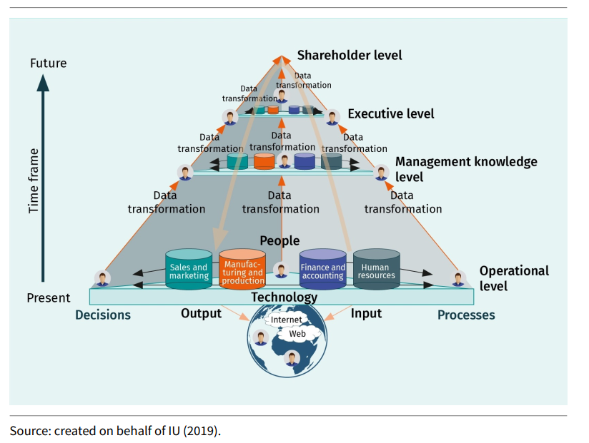

In our daily lives, we define success as the achievement of objectives, irrespective of the steps that enabled the success. Since the specifications of an IT project are expected to change and be accommodated at every level of the project, it becomes difficult to define success without considering other parameters. Typically, when specifications change, it influences development time which can potentially influence cost. For this reason, the *iron triangle* sets three constraints as the interdependence of *project scope, schedule and cost* (Pollack, Helm, & Adler, 2018; Sanchez & Terlizzi, 2017). The iron triangle states that time, scope and cost together contribute to the quality of a project, with changes to one element affecting the other two. This means that, for a project to be successful, these constraints need to be balanced throughout the project life cycle to ensure that the project objectives are met.

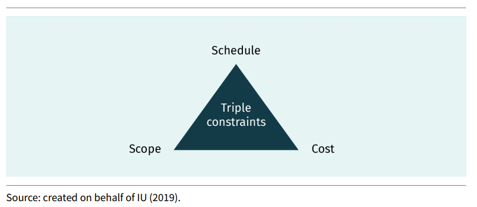

Given the complexity of IT Projects, the iron triangle might not be enough to handle the changing conditions around the IT project. As a result a **quintuple** with five constraints can adopted to handle this complexity. The dimensions of the quintuple are *schedule, cost, financing, technical and context*. Technical, Cost and Schedule of the quintuple correspond to the Scope, Cost and Schedule of the iron triangle respectfully. The Content of the quintuple considers the environment where the end result of the project will be used. It takes into account the people, culture, political and demographics as well as the impact of the product or service in its environment. The financial dimension is concerned with the body responsible for financing the project. This could be private or government stakeholders. This is relevant when the operations of the project cross borders. One difference between traditional project and IT projects is that IT projects are *sociotechnical*. This means that the interaction between stakeholders(e.g users) and the service or product. The product is itself is built using technologies. As a result, stakeholders can infleunce the way the application is technically built. On the other hand, traditional projects are always premeditated then implemented without seeking users opionion. Another difference is that, IT project results, in an organisational context, play a supporting role to other departments of the organisation. For instance, an application can be developed for a particular department. For this, reason, IT projects can initiate changes in the organisation's structure.

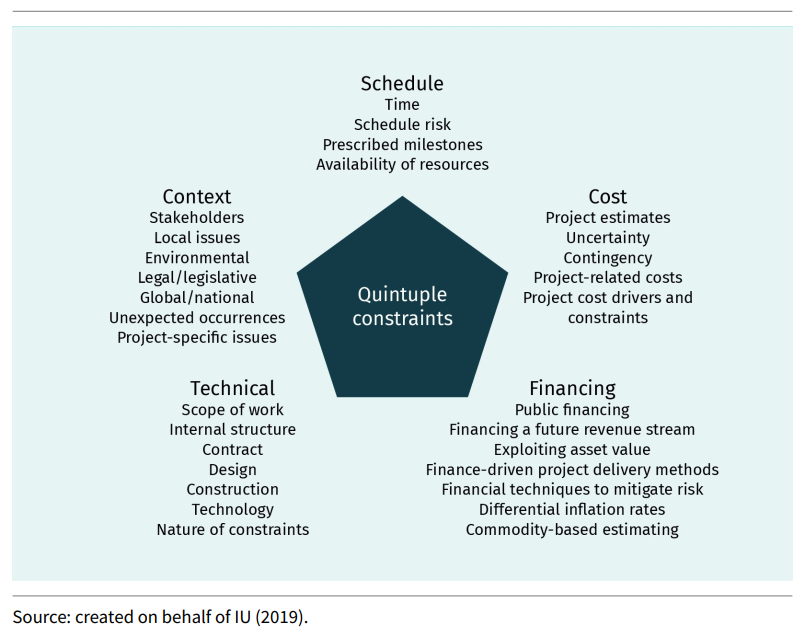

### Overview of Typical Roles and Phases of IT Projects
IT Project endeavors can be of different sizes and types, ranging from simple applications to complex software systems, irrespective of the size of the company. To ensure that the project delivers as expected, it is important to define roles and responsibilities as well as setting milestones to track the progress of the project. The following image illustrates a project structure for large plan-driven projects. It shows the different roles that can exist.

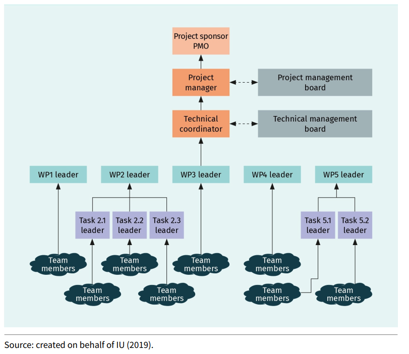

**Project sponsor** 
Usually the top-level position and responsible for the project's business case. Some organisations create a Project Management Office (PMO) that is typically a separate entity in charge of the major organisational project. This office is responsible for providing the project teams with labour and material, and to ensure that the project needs are addressed so the project delivers as promised. The success of the project depends on the commitment of the PMO.
**Project Management Board (PMB)** 
They have similar responsibilities to the project sponsor and/or project management board. This involves the monitoring of the overall progress and direction of the project such as:
- Risk evaluation
- Resource usage
- Cost incurred
Identified deviations from the base plan or misunderstandings between stakeholders are corrected by the PMB.
**Technical Management Board (TMB)** 
- Support the PMB, especially in large projects. They make decisions on issues that are not resolved by the WPLs.
**Project Manager (PM)** 
This role is in charge of the project and:
- Responsible for the overall project management, including reporting to the project sponsor or the PMO.
- Interact with the project sponsor to discuss contract-related issues
- Chair regular management meetings and coordinate activities across the project.
- Monitor the overall performance of the project
- Coordinate technical work
- Supervise the preparation of the final deliverables
- They require technical skills but not specialisations like programming or operations.
- Responsible for administrative tasks of the project, e.g. collect administrative reports from project partners and forward them to the PMO or project sponsor.
- Update the consortium agreement between the participants
- Administer project resources and project spending
- Manage the overall ethical and gender issues, etc.
The soft and hard skills required by an (IT) project manager are listed on the following image. Notice that the soft skills are qualitative while the hard skills are quantitative.
- Ability to detect and handle risk. They can use *project triggers* to identify (indicators) risks within the project so it can be handled before it becomes significant.

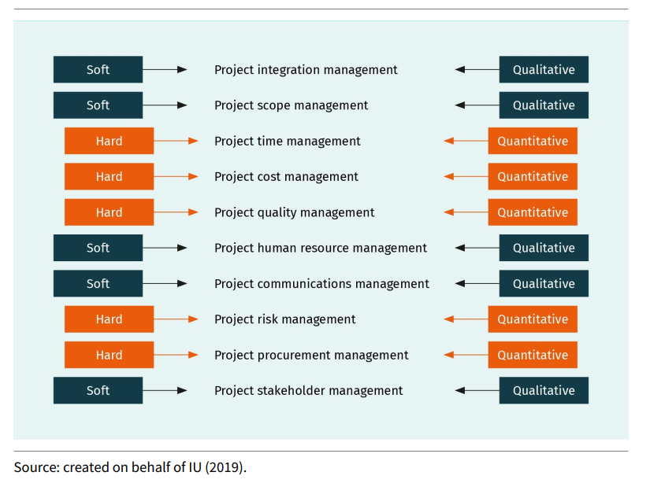
**Technical coordinator (TC)** 
This role is used in specific situations, i.e. where the project manager does not have the background knowledge and skills to judge and oversee every technology involved in the project. This role has the following responsibilities:
- It is a supporting role to the PM
- Addresses the technology needs of the IT project
- Monitors all development plans and specifications
- Identifies work packages (WP)
- Oversees all work package leaders (WPL)
- Establishes responsibilities and duties
- Creates and maintains the project's technical library (Bogojevic, 2017). This library tracks every experience surrounding the project, including issues and their solutions, plan alterations and their justification, etc.
**Work Package Leader (WPL)** 
- Assigned to each WP
- Responsible for all activities within their WP
- Collaborates with the technical coordinator.
- Ensures that the target deliverables are delivered on time
- Shares project reports with the PM and TC.
**Task Leader (TL)** 
Similar responsibilities to the WPL, except that the responsibilities are tied to specific tasks.
**Individual Team Member (ITM)** 
They perform the assigned tasks that must be fulfilled to achieve the specifications of the project. Team members may be pushed around depending on their skill levels, workload and resources available for the project.

Not all projects require a project manager, especially small projects. In such cases, it is advisable to adapt to **agile** methodologies to handle changing environments. Also, agile methodologies encourage self-organisation of the development team, without specific leadership role but with supporting roles such as **product owner**.
**Product owner** 
Responsible for managing and prioritizing the work to be done, with focus on optimizing the value to be gained.
**Scrum master** 
In the *Scrum* agile project management approach, this role is responsible for supporting the project processes and their implementation. *Srum* itself is the practice of daily communication to enable reassessment of short-term working plans and goals in Agile project managment situations

## PROJECT PHASES
After establishing a project structure, especially in a plan-driven project, the next stpe is typically the identification of the activities to be followed in achieving the project goal and objectives. These activities are usually grouped into phases termed project phases. These are the steps in time required to develope product, service or solution(Larson & Gray, 2015). Typically, a project is an endeavor in response to a client's specific request. This means that project phases are also specific to the project. Depending on the expected outcome of the project, emphasis is laid on some phases and the phases of IT Projects often overlap to a great extend. Due to this overlap, there are general stages that are accepted in IT Projects. This is illustrated and described as follows:

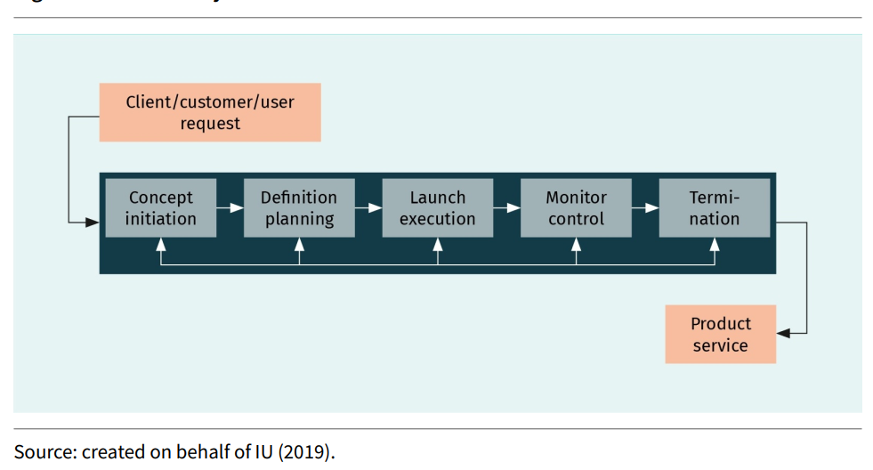

**CLIENT/CUSTOMER/USER REQUESTS** 
This is not a project phase. This represent the stakeholder i.e those who need or will use the service, product or solution.
1. **Concept Initiation** 
- All the preliminary requirement of the project based on the client request are identified to formulate the scope of the project.
- Feasibility study is done to determine the project's domain and success chances based on the available resources and market demand.
- Project Sponsors are assigned and project stakeholders are determined.
- A kick-off meeting is organised to bring the project actors together and formiize the project's commencement. In this meeting workload assignment and preliminary planning could take place.
- The end result of this phase is a project charter, which is a written document that aknowledges the existence of the project. It includes the purpose of the project, measurable objectives, high-level description of the project requirements and risks, estimated milestone and budget, criteria for project approval and the names of both the project sponsor and project manager(Martin & Haggerty, 2017). 
2. **Definition Planning** 
- The project leadership decide how to proceed. This is communicated in a form of a plan that will guide everyone involved in the project.
- The baseline for the project scope, schedule and cost is established. Further deails regarding the project will be built on this baseline. The baseline is equally the benchmark for evaluating the progress of the project.
- Subsidiary plans will be evaluated for: 
    + various project components and contraints
    + Quality and risk management
    + Resources and procurement management
    + Stakeholder and communication management
- Determination of the duration of each phase
- Determination of the tools and techniques that will be used
- Specify areas of overlap and interactivity between the phases
- Describe how work will be executed
The output of this phase is the *project plan*. This typically includes dedicated plans for schedule, scope, risk, procoss improvement, human resources, procurement, configuration, communication and change management plans.
3. **Launch Execution** 
- This phase is built on the project plan and marks the beginning of the realisation of the project components following the activities outlined in the plan.
- Project team is establised
- Activities like procurement, quality assurance etc is done in this phase
- Stakeholder update and review of deliverables is done.
4. **Monitor Control** 
- This phase runs in parallel with most other planned work
- IS and SHOULD evaluations are done to capture differences. Based on the difference establised adjustments may be made to align the project with the specifications. Also, decisions can also be made whether objectives will be met or not.
5. **Termination** 
- Project is completed and final product is shipped.
**Product/Service/Solution** 
This is the end result of the project and it should meet the expectations of the client. It is not a project phase.

It can be observed that iterations are not included in this project phases illustration. This is because it is related to *plan-driven* project management. However, in real-world projects, iterations or loops are very important to create flexibility that supports handling of changes in specifications. This flexibility is emphasised in agile project management approaches where development of the product/service/solution can start with a very superficial plan with details added later as the project progresses. The agile Scrum methodology supports working in sprints(iterations) to leverage deliverables.

## Risks and Challenges of IT Projects

In every situation where decision is made with an expected outcome, there is always a level of Risks associated to it. In IT Governance, Risk is defined as the *effect of uncertainty on objectives*. But according to **NIST**, risk is a *measure of the extent to which an entity is threatened by a potential circumstance or event, and typically a function of:*

Risk = Threat * Vulnerability * AssetValue

Risk can be **Inherent or Residual**
+ Residual Risk: These are risk that remain after risks assessment and the implementation of risks controls.
+ Inherent Risk: Risk that exist in the absence of controls or when controls have been designed and implemented.

In IT project management, risks are uncertainties that can infleunce the project outcome positively or negatively(Cagliano, Grimaldi, & Rafele, 2015). Negative risks are *threats* while positive risks are *opportunities*.

There are several approaches used by organizations to deal with risks. In general, it is done via one or more of the following actions:
1. Risk transfer: It doesn't mean that an organization becomes nonchalant, however, an organization transfers their risks to another entity. For instance, via insurance. In the case of data breaches or leakages, the insurance covers the cost entirely or partly.
2. Risk acceptance: Identified residual risk may be accepted by managers to avoid further expenses to handle this risk. This is when the risk is considered to be at very low levels for the organisation. In the event of damage as the result of accepted risk, the manager(s) who accepted the risk may be fired or reprimanded.
3. Risk avoidance: is usually applied if a risk is considered too high in comparison
with the benefit involved. E.g An organization may avoid purchasing or upgrading tools/services and continue running operations with existing tools whne the new tools or upgrade don't bring features that add significant value to the organisation.
4. Risk mitigation: Tries to reduce the risk to an acceptable level by either reducing the probability of the risk occurring or reducing the damage it could have should it occur.

**Risk Attitude in IT Project Management**
Whether an organisation considers risks to be at acceptable levels or not, depends on their attitude towards risks. This is infleunced by the environmental and idiosncratic factors of the individual decision-maker or an organisation as an entity. Individuals or organisations typically have a risk threshold that indicates the level of uncertainty or the level of impact they can afford toward a specific interest. The attitute of an organisation towards risks can either be *avverse, neutral or taking*. Risk-neutral actors are usually reserved in their consideration of uncertainty(utility) and gains(payoff). On the other hand, risk-averse and risk-taking actors are pessimistic and optimistic respectfully. The following graphs indicate the attitute of actors based on the utitlity and payoff they perceive. Some other factors that infleunces the attitute of an individual towards risk include:  perception of the situation, tolerances, biases, drives, interests, cognitive capabilities,
and emotional state. Many of these factors might seem extreme, but they often lead to deliberate ignorance that influences the choice between which information is of value and which is irrelevant and excluded (Kutsch & Hall, 2010).

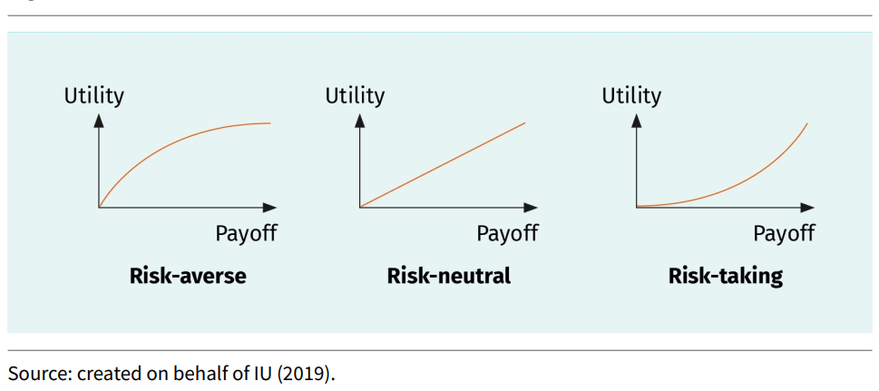

**Handling Risks**
Risk and Control is generally handled in six steps. These include:
1. Determining the risk level the organization is willing to take i.e the risk appetite
2. Perform *risk assessment* to identify threats or weaknesses that can harm the project. Risk assessment is an activity undertaken to systematically examine the project to determine potential shortcoming that can harm the project.
3. Rank identified threats according to the level of damage it can cause to the project. This could be via quantitative(score ranging from 1 to 10) or qualitative(low, medium, high) measures.
4. Design risk mitigation, avoidance, acceptance or transfer solution
5. Implement designed solution while taking cost into consideration. This is where threats are being handled.
6. Document mitigation, avoidance, acceptance or transfer approach for future use in similar situations. 

# UNIT 2: ORGANISING THE WORK
Organising work begins right after the official approval and commencement of a project. This core activity sets how work will be distributed between the various project activities, the sequence of the activities, their outputs in terms of deliverables and milestones, how the product or service will be tested for conformity to user requirements etc. It is done base on the available information at the time(input), the tools and techniques to be applied to convert the input into output, and the actual output. These are typically included in the *project charter*, which is the output of the project initiation phase. To organise the project work, the project baseline is first of all developed in terms of the *scope, schedule and cost*. This is necessary as it is used as the benchmark to monitor the progress of the project(Herroelen & Leus, 2004). However, the overall planning will be composed of subsidiary plans for managing scope, schedule, cost, requirements, procurement, quality, process improvement, human resources, risk, communications, and stakeholders.

## Project Breakdown Structure, Workpackages
To visualise the work to be done in a project can be overwhelming, especially in large IT projects. Visualisation starts by breaking or decomposing the work into smaller and manageable components that can be completed independently, in sequence or in parallel in what is called *work breakdown structure (wbs)*. An example of a WBS for a fictive project to develop a cRobot is shown in the imaage below. This project is decomposed in a tree-like structure. The root is the name of the *product* to be achieved by the project, while levels 2 and 3 constitute the work packages. The leaves are the tasks to be realised to build the cRobot. The completion of each task should result in a *deliverable*. The scope, schedule and cost is determined at the leave level for every task, then summed up to the root level to determine whether it sums up to the overall scope, schedule and cost of the project. In case of differences especially when the sum of the scope, schedule and cost of the individual tasks exceed the expected scope, schedule and cost of the project, then the WBS must be refined. This could be done in an iterative process. It is worth nothing that, the number of levels in a wbs depends on the type and size of the project. Smaller projects use fewer levels or may not require a wbs at all. Decomposing a project in a treelike structure is one approach. In an agile framework, work is decomposed into *epics, user stories and tasks*, where *tasks* are the small packages of work that can be completed in *one iteration*. In a *Scrum* methodology of an agile approach, an *iteration is called a sprint*.

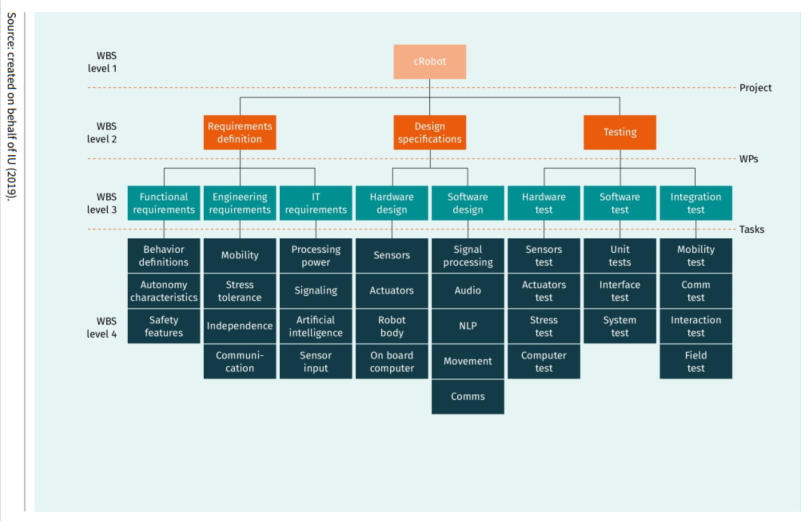

**Definitions** 
* sprint: A period of time to work on a certain element of the project to move the process forward within a Scrum management process. 
* epic: "A high-level or complex user story to be refined into more detailed user stories" (PMBOK, 2013, p. 5). 
* user story: is “a narrative description of a software requirement, function, feature, or quality attribute, presented as a narrative of desired user interactions with a software system.” (PMBOK, 2013, p. 6). A user story should be understood as a task.
* traceability matrix: A grid that links the requirements of the product/service with the work accomplised in the task. Since each task results in a deliverable, this means that each deliverable adds business value to the product being developed in the project(Kirova, Kirby, Kothari, & Childress, 2008). This documentation is important irrespective of the size of the project and also helps to determine deviations between requirements and implementation.

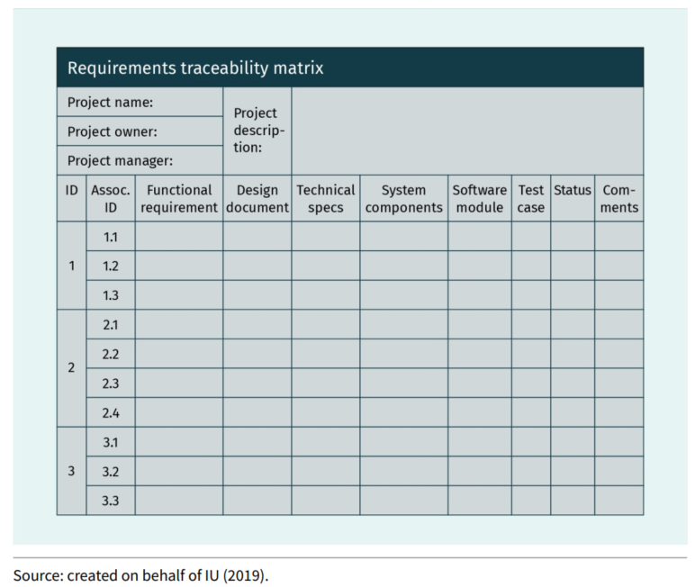

## Prioritization
This activity determines the order in which, the identified requirements of the product to be implemented in the project, will be performed. Prioritisation could be based on *risk, funding, and other considerations relavant to the strategic objectives of a project and in relation to other ongoing projects in the organisation*. A advantages of prioritisation is that:
- It allows project monitoring
- Creates alert when task breakdown and priority shift
Typically, tasks with urgency get the highest priorities, and the project team allocates immediate attention and resources to them so that they can be completed on time and on budget. On the other hand, important activities can be delayed. As a result it allows the project team to work proactively, which creates room for rational decision-making and openness to new opportunities. To eliminate subjective assessement in order to determine whether they are urgent or important, it is recommended to use the *Eisenhower* matrix with four quadrants to determine their priority levels. This matrix is built on the interaction between *urgency* and *importance* with each axis have a low and high point. When an activity is high on both importance and urgency, the it is considered critical for the success of the project. Thus it becomes top priority. When the importance is high and the urgency is low, then focus can be laid on project goals by appropriate planning, searching for opportunities, productive collaboration and development. In cases of high urgency and low importance, the attention is important but the task could resolved later without it posing serious effect on the project. In the case of low importance and low urgency, the task can be ignored to avoid wasting resources. The image of the Eisenhower matrix is shown below.

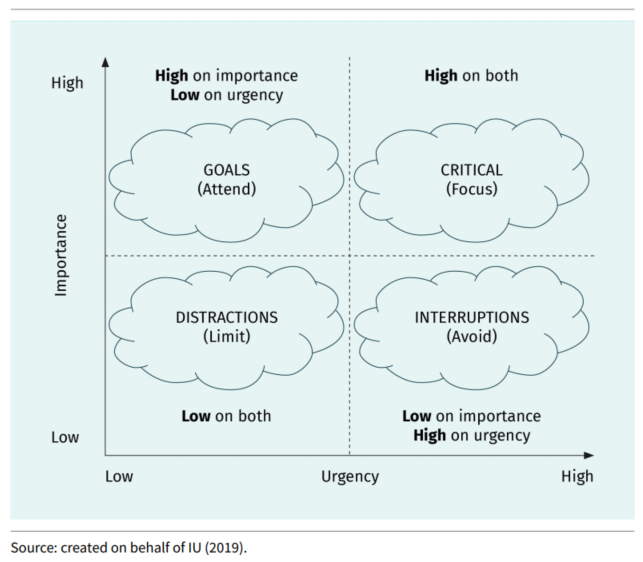

Another approach for identifying or setting priorities is by the use of the *kano model* (Lo, Shen, & Chen, 2017). This model lays emphasis on quality control in relation to customer satisfaction. Its purpose was to challenge the conventional belief that customer satisfaction is proportional to the improvement of every aspect of a product or service. It thus asserts that improving certain aspects with a certain amount of effort can meet *basic customer* expectations, while improving others with same amount can *delight customers*. This method abstracts requirements into categories, allowing their identification through classifiers rather than by an arbitrary and often subjective attachment of attributes to requirements. Depending on the granularity level of the product or service in development, the model splits the requirements into *three, four or five categories*. An illustration of the kano model with 3 categories is as shown below:

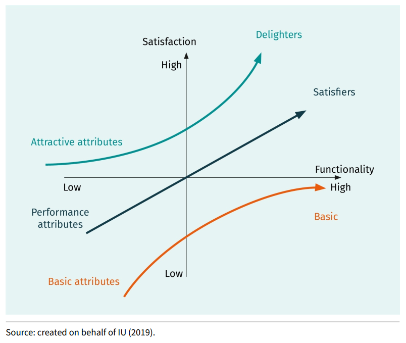

**Description of the 3 Categories in the example kano model**

- Basic: These are the absolute minimum attributes or functionalities that the product must have, without the customer/user explicitly giving it as requirement. E.g the cRobot should be mobile by default. 
- Satisfiers: These are requirements whose accomplishment proportionally increases customer satisfaction. For instance faster response time of the cRobot. Satisfiers should be perceived as performance attributes.
- Delighters: These are requirements whose accomplishment can attract, delight or "blow the mind" of the customer. E.g implementation of a human-like head on the cRobot. These requirements usually deliver attractive attributes on the feature.

Another prioritisation technique often considered in project management is *MoSCoW*. The uppercase initials stand for Must-haves (M) i.e bare minimub, Should-haves (S) i.e vital but not mandatory, Could-haves (C) i.e nice to haves, and Won’t-haves (W) i.e irrelevants. The Os are included for mnemonic convenience. This prioritisation technique developed by Dai Clengg of Oracle UK in 1994 helps project teams to identify the order of *importance* of requirements in software development. Instead of number, words are used to determine importance in other to widen the scope of each category and trigger discussion of what is importanct. The major drawback of this method is that: When used in a project for a development of a product that is used by e.g different departments of an organisation, the priorities of the features to be implemented may vary accross the departments involved. To solve these neuances, the approach is often used as a hybrid which constitutes the the simplicity of the customer-oriented view of the kano approach and exploration of the requirements of the project. For instance, Must-haves become the basic functionalities while the Should-have boost customer satisfaction. They cover the satisfiers and the delighters. This hybrid approach offers deeper insights into the requirements and can support more informed decision-making on the tasks. An illustration of this hybrid model is shown on the image below.
--insert image here--

## Time Planning, Milestones, and Gantt Chart
The prioritised set of tasks creates clarity on the expected implementations that must occur to achieve the overall projective objectives. It also covers the constraints that must be taken into consideration. With that in mind, the actuall planning of the project activities can begin. During planning, all subsidiary plans are defined, prepared and assembled into a comprehensive project management plan. The details of the project plan include how the project will be executed, monitored, controlled and when the deliverables will be submitted as well as when the product or service of the product will be delivered to the client(Papke-Shields & Boyer-Wright, 2017). This is the foundation for controling and monitoring the project to ensure that the deliverables are leveraged on time and on budget. According to the agile framework, a fix plan does not allow for adaptation when project requirements are modified in the course of the project. For this reason the agile framework suggest only an abstract plan should be used at the beginning so details can be added as the project progesses. A project management plan is thus suitable for large plan-driven projects while agile is suitable for small project that can be executed in iterations. The sequence of activities in time is the most important aspect of any plan whether in project management or not. There are a good number of tools and techniques for scheduling projects. Some of them are: *Precedence diagramming, Program Evaluation Review Technique (PERT), Leads and Lags, and Gantt charts*. The latter is the most popular technique and often required in formal project proposals. The other methods, are mostly used to support the Gannt chart to improve its accuracy.

### Gantt Charts
Usually activities have a start and a finish, and also exhibit dependencies. This means that, it is possible to pair dependent activities into successor and predecessor. There are four pairing possibilities, which are: 
+ Finish-to-Start FS: The successor starts after the end of its predecessor. E.g In the cRobot project, testing can only start after all the components of the robot are put together.
+ Start-to-Start SS: The successor starts between the beginning and the end of the predecessor. E.g The software development can start as soon as the hardware has been finalised, and is in construction. However the software dev cannot finish before the contruction of the hardware is done.
+ Start-to-Finish SF: The succesor finishes before the predecessor starts. Some of the software dev will be completed before the hardware construction is completed.
+ Finish-to-Finish FF: The successor can finish after the predecessor is finished. Unit test is done before the system test is performed.

This precedence diagramming is illustrated on the following image:

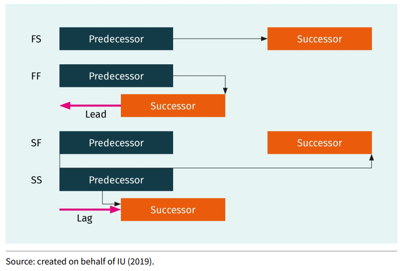

### PERT Charts
The program evaluation review technique (pert) uses a representation of each project task/activity as a node with information about the *task identifier, its duration, the earliest and latest times work can start on the task, and the earliest and latest times it could finish*. The directed edges are used to connect predecessor nodes to the successor nodes. The process starts by creating a node for the first activity based on the prioritise list of tasks. Then subsequent tasks are added to the chart as nodes. The red edges represent the critical path of the project. The tasks on this path have zero flexibility in terms of starting and ending times. This means that a delay on any task on this path leads to a delay in the overall schedule of the project. The following image illustrates the components of a node in a PERT chart. It is followed by an example PERT Chart for the cRobot project. Notice the *critical path* and indication of the *slacks*. *A slack is the maximum lead or lag that a node has before its implementation starts*. The slack is the difference between the earliest start time and the latest start time of a node. For all the nodes on the critical path, the slack is always zero. This means that, the tasks must be executed on time. To determine the earliest endtime of a task, add the task duration to the earliest start time of the start. The earliest endtime of a predecessor is the earliest starttime of the successor. To determine the earliest starttime of each task using this approach is called *forward pass*. The *backward pass* is similarly used to determine the the last starttime of the each task.

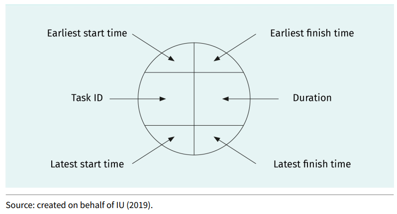

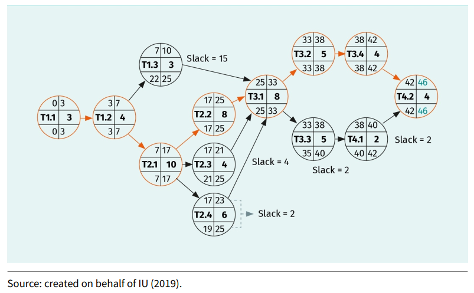

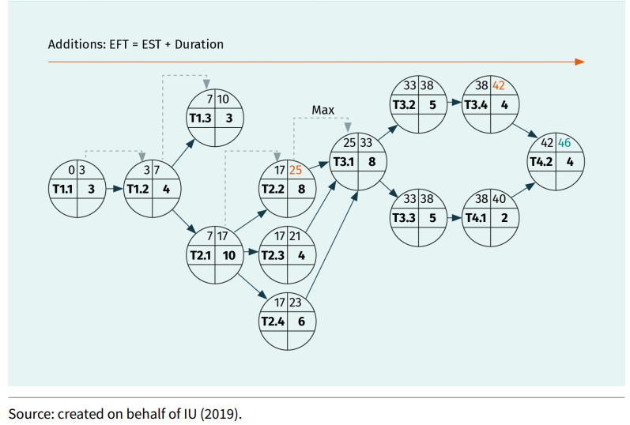

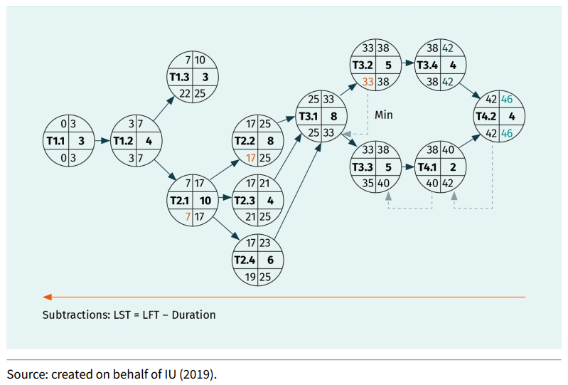

The relationship types in precedence diagram is shown on the following images.
From the pert charts with slack values, the relationship types can be visualised as follows.

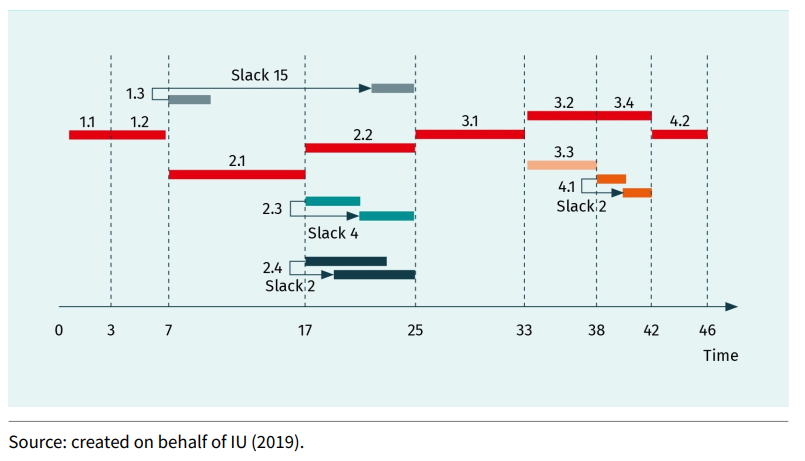

The resulting gantt chart is as follows.

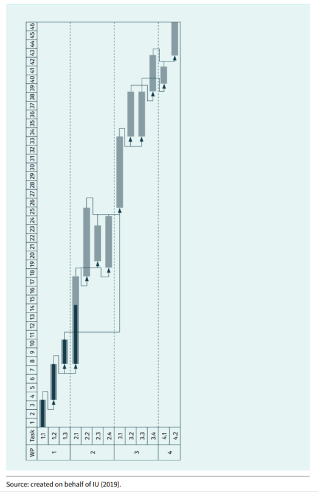

## Definition of Done(DoD)
Definition of Done: This is a previously agreed upon set of criteria, or definition, concerning a task that, when completed, is considered to be finished(Silva et al., 2017). Deciding on a DoD is the kind of activity that is initiated and supported by the team and not by any party external to the team entity. If it is to successfully support the team, it cannot be imposed but rather be collectively adopted.

### Software Quality Attributes

1. Satisfaction
- usefulness
- trust
- pleasure

2. Effectiveness
3. Freedom from risk
- economic risk mitigation
- health and safety risk mitigation
- environmental risk mitigation
4. Efficiency
5. Context coverage
- context completeness
- flexibility

The standard also defines a product quality model that relates to the static properties of software and dynamic properties of the computer system. It is composed of eight quality characteristics and their subcategories that are defined as follows:
1. Functionality suitability
- functional completeness
- functional correctness
- functional appropriateness
2. Performance efficiency
- time behaviour
- capacity
3. Usability
- appropriateness recognizability
- learnability
- operability
- user error protection
- user interface aesthetics
- accessibility
4. Reliability
- maturiy
- availability
- fault tolerance
- recoverability
5. Security
- confidentiality
- integrity
- non-repudiation
- authenticity
6. Compatibility
- coexistence
- interoperability
7. Portability
- adaptability
- instability
- replaceability
8. Maintainability
- modularity
- reuseability
- analyzability
- modifiability
- testability

### Quality Gates
An alternative form of intermediate acceptance of results that is more common in large projects is the quality gate. A quality gate consists of a definition of results to be delivered at a certain point in the project, such as at the end of a project stage, plus some form of
formal review to check that all expected results are available in adequate quality (Kneuper2018, p. 26).

# UNIT 3: COST ESTIMATION AND CONTROLLING
## Introduction

Project cost estimation happens after activities are prioritized and sequenced, and includes budgeting, financing, funding, and cost control within the approved budget. Estimates must account for both acquisition costs and recurring/indirect costs (for example, fuel, maintenance, support), which are often hard to predict. High-quality estimates are judged by factors like accuracy, confidence, credibility, precision, reliability, documentation, uniformity, validity, and verification. The cost estimates are weakened by unclear project scope, limited team experience, long planning horizons, and large/complex teams that increase coordination uncertainty. Estimation is usually easier in adaptation/maintenance projects (known systems) than in development projects (new concepts and outputs).
**Agile vs plan-driven**
Agile accepts estimation uncertainty by using short iterations, prioritizing highest-value work first, and usually fixing cost and schedule while treating scope as variable. Plan-driven management typically fixes scope in advance and allows cost and/or schedule to vary if needed.

## Challenges of Cost Estimation in IT Projects
A practical way to estimate the cost of the project, is to calculate the cost of all the work packages(wp) and sum the value together.This is referred to as *project cost without contingency*. This method is straightforward, and is suitable for small and simple projects. In reality, especially in large and complex projects, cost estimation is a challenging process that requires an understanding of *costing techniques and the multiplicity of elements that infleunce the process*. Cost estimation or prediction is usually based on the information available at the time, and requires among others, the consideration of tradeoffs and risks such as in-house or outsourced development, leasing  or buying equipment, centralising or distributing work, and sharing of resources. Additionally, there are other factors such as time, unit of measurement and skills of the project team members. For instance, the cost of a component at the time of cost estimation could be different from its at the time this component is required. Using, different units of measurement can lead to inconsistencies in cost estimation. The units of measurement as well as the floating point must be agreed before cost estimation starts. In the implementation of the project, it might occur that some team member need to take extra training to be able to implement the requirements of the project. All these put together can infleunce cost. A good cost estimate for a project can be achieved by combining *expert judgement and a variety of techniques* that have been developed for this purpose. A good estimate is necessary for a cost-benefit analysis. The result of a cost-benefit analysis enable the project sponsors to decide whether to start the project or not. Some typical metrics used for cost-benefit analysis include:
1. Return on Investment (ROI): Net gain after a certain amount of time. E.g You invest 100€ today and in 2 years you have 180€. 
Your roi is: (180/100) * 100 = 80%.
2. Payback period: The time required to equalise losses with gains. E.g You invest 100€ today and in 3 years you have 100€, then your Payback Perion is 3 years
3. Net Present Value (NPV): The amount of money needed to be invested today to ensure a certain income at a later point in time.
*NPV = Future Value / (interest + 1)^ timePeriods*
4. Profitability Index: NPV / Investment or project cost e.g NPV = 180€ and Porject Cost = 100€ then Profitability Index = 180/100 = 1.8 => An 80% increase in profits. 

The chosen metrics will provide some numeric estimates of the project cost in relation to the expected returns. Deciding what metric and cost estimates will be used can be very challenging—too few metrics might cause an overreaction, as they might not represent reality accurately, and
they might be too difficult to understand and interpret. Too many metrics, on the other hand, might be a waste of time, as they might provide too much information to allow for what is critical to surface, and they might have little or no value especially when innovations are considered. A typical way to address uncertainties and challenges of producing cost estimates is to include *contingency reserves*. This is the extra budget allocated to activities or wp to account for risks("known-unknowns"). At the project level, it is termed *management reserves*. The following image illustrates the components of a project budget.

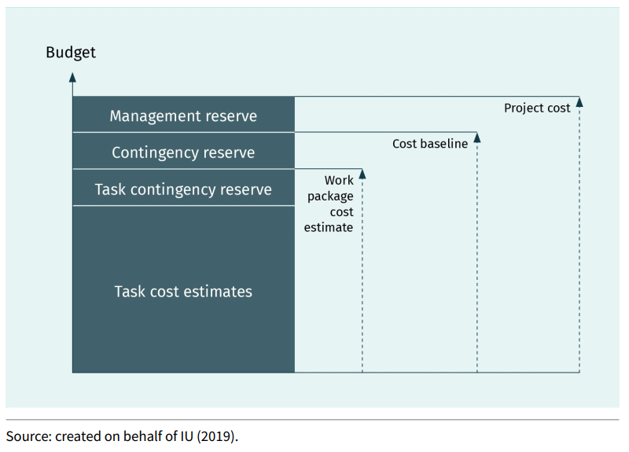

## Estimation Techniques
Contingences are not quite efficient in accounting for cost related deviations that could occur in the execution of the project. A more deterministic approach that handles the weaknesses of contigences is a *cost-risk analysis*. In this approach, the contigences are allocated to the work packages or entire project based on the risk appetit and the degree of flexibility in cost variation that the project stakeholders can allow. There are several cost-risk analysis approaches that can be used in practice. Some of them are described as follows:
1. **Three-Point Estimation** 
Considering the distribution of cost with its probability of occurance, a three-point triangular approximation is drawn on the distribution indicating points for *optimistic, most probable and pessimistic*. Optimistic implies it is expected that nothing will happen while pessimistic implies everything will go wrong and most probable is the cost that is most likely to be incurred. The optimistic and pessimistic values are extrem and less likely to occur. For this reason, the most probable cost is chosen as the cost estimate for the project. See image below.

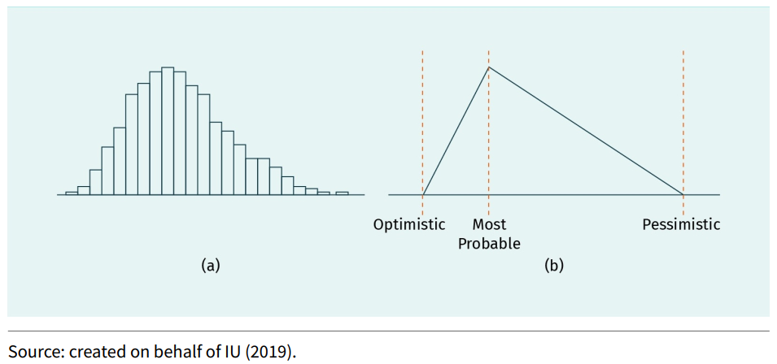

2. **Expert Estimation** 
It is possible for the project team to assess the project and come up with a cost which they all with. However, there could be cases where the entire team lacks the levels of expertise to provide realistic estimates. For this reason, it is advisable to consider seeking for expertise from other parts of the organisation or from consultants. This is because expert judgement, guided by experience, can provide significant insights into the potential cost of equipment, personnel and operations.

3. **Function Point Analysis** 
Information systems and software are developed to fulfill user needs. Some of this include commercial information systems. Function points or function point analysis(fpa) is a cost estimation technique used when developing this kind of system or software. Function points are units of measurement the expresses the amount of information that a system provides to users. On the other hand, function point analysis is a technique that quantifies the functions contained within software in terms of their value to the user. FPA also measures the software development and the maintenance cost independently of the technology used for the implementation. There are different variants of FPA. The ones we explore is based on the the fact that software applications manipulate input to produce output resulting to two categories of functions which are *data functions* and *transactions*. The data functions are made up of internal and external resources that affect the system while the transaction function is made up of the processes that are exchanged between the application and the external actors like the user or other applications. The transaction function counts elements like *inputs, outputs, interfaces, files and inquiries*. It uses this to calculate the *unadjusted function points (ufp)*. The following are five functions that belong to the data functions and transaction functions.

1. Transaction functions
    - Number of input items
    - Number of output items
    - Number of user inquires
2. Data functions
    - Number of internal logical items
    - Number of external interfaces

Basically, each function within the data and transaction function is assigned a weight, based on its complexity, which could be low, avg or high. Then the software that is be developed is broken down and assigned to these functions with their exact weights. See example of cRobot as illustrated on the following images.

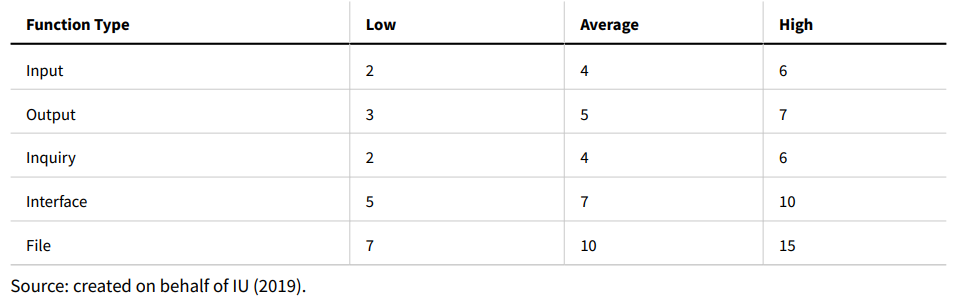

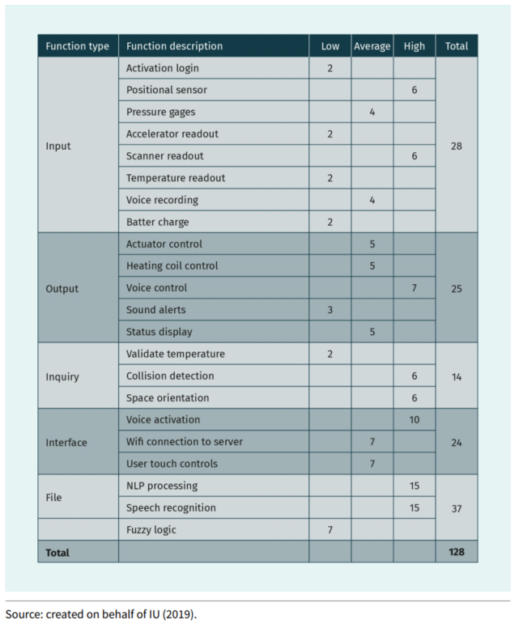

Once the latter results in a ufp. Once the ufp is gotten, it will then be adjusted based on the general functionality of the application. There are a set of characteristics that typically cover the *business aspects of software applications (basa)*. The values of the basa represent the total degree of infleunce(tdi) which can range from 0(no influence) to 5(strong influence). The sum of the values represent the total degree of influence of the application. This value is then further used to calculate the the complexity adjustment factor(caf) of the application through the following formula:

**CAF = 0.1 * TDI + 0.65**
Based on the following image of the basa, the CAF is:
CAF = 0.1 * 34 + 0.65
CAF = 0.99
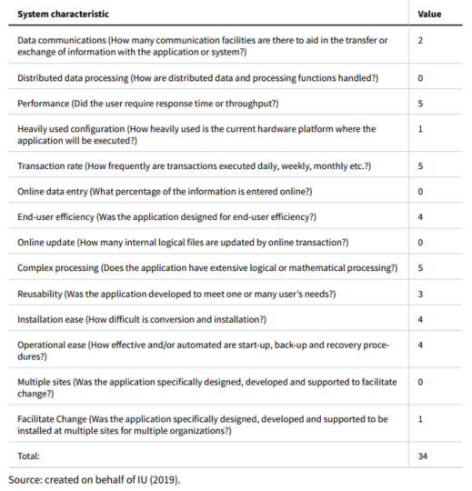
The estimate of the function point(fp) is gotten by the product of CAF and UFP values i.e
FP = CAF * UFP
FP = 0.99 * 128
FP = 127

Disadvante of fp is that the involve subjective evaluations that are not always accurate and require conversion to reflect effort and cost. However, they are programing language independent.

4. **Planning Poker** 
Planning poker is an agile estimation technique where the people doing the work estimate it together to avoid outside pressure and unrealistic low estimates. It is used after work is broken into small items like user stories or tasks. Each team member independently estimates effort using agreed values, often based on the Fibonacci sequence or story points. Everyone reveals estimates at the same time, the highest and lowest estimators explain their reasoning, the team discusses differences, and the process repeats until a consensus is reached.

## Cost Controlling Using Earned Value Analysis
Earned Value Management is preferred because it goes beyond basic cost estimation by also considering project constraints. It measures project performance and progress by combining scope, schedule, and resource information. EVM integrates the scope baseline and cost baseline, and together with the schedule baseline they form the performance measurement baseline used to assess project progress. EVM uses three core measures: planned value (PV), earned value (EV), and actual cost (AC), which can be tracked at project, work package, or task level over time or cumulatively.

Key indicators are:
- Planned Value PV: the *approved budget* for scheduled work.100€ can be approved for a task
- Earned Value EV: the *budgeted value* of work actually completed. 100€ can be approved but 75€ is allocated.
- Actual Cost AC: the real cost of completed work, The task might cost 90€.
- Schedule Variance SV = EV - PV: shows whether the project is ahead or behind schedule
- Cost Variance CV = EV - AC: shows whether the project is over or under budget
- Cost Performance Index CPI = EV / AC: measures cost efficiency; below 1 means cost overrun
- Schedule Performance Index SPI = EV / PV: measures schedule efficiency; below 1 means less work completed than planned
SPI helps assess schedule performance, but critical path analysis is still needed to judge the actual finish date. The following image illustrates the earned value analysis.

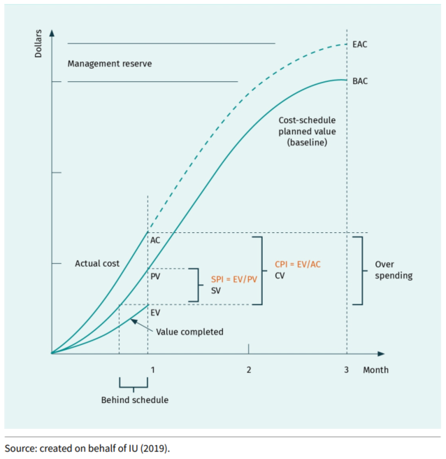

A burn down chart, a variant of EVM, is *an agile project* tracking tool that shows how much work remains in a sprint over time. Unlike EVM, which measures work completed, it focuses on the remaining effort and ideally declines from 100% to 0% by the end of the sprint.

## Risk Management
In the summary for *coporate governance of IT compliance and law*, read **ISO 31000:2018 Risk Management Process**.

As already seen, the EVM is a quantitative method used for estimating the effect of risk on the project. On the other hand there are several qualitative method used for measuring the effect of risk on the project. Some of this include gathering information from experts, reviewing past projects in similar domains, performing *assumption analysis*, cause & effect diagrams, infleunce diagrams and SWOT analysis. This can help the project team to estimate their risk appetit based on the likelihood of the risk to occur. An assumption analysis is a technique that involves making assumptions when planning projects in order to minimize risks. The likelihood and risk impact matrix is shown below:

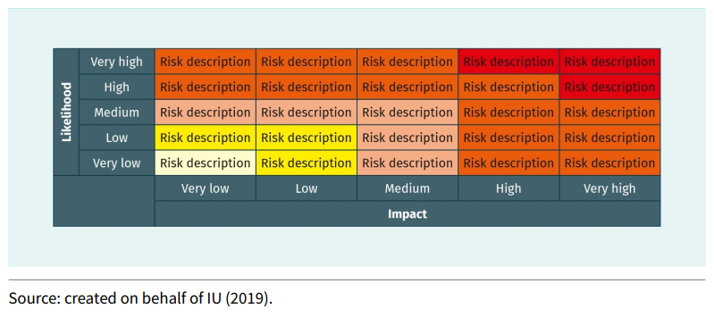

# UNIT 4: THE HUMAN FACTOR
A project team might be compose of individuals within the same organisation, location or beyond borders, who are expected to work together to deliver the expected results. The team members may inlcude senior management, project sponsors, cutomers, end users, suppliers etc. The challenge of a PM consist of attracting the right expertise, that will work together and stay motivated throughout the project lifecycle. To keep up with the human side of project management, it requires experience with human interactions, understanding human behaviour and communication as well as negotiation skills. Project managers must intentionally invest time to ensure that the team has a structure, and respect both team or company culture as well as processes. The structure sets roles and responsibilities while the culture builds team spirit. On the other hand, the proceses define rules, guideliness or principles within which the structure and culture coexist. Agile project management emphasises on the human side as the basis for creating successful teams.

## Vision Keeping
The project vision clarifies the purpose of the project and eliminates confusion about the direction and goals of the team. While the vision is the big picture, the *vision statement* is a precise formulation of the vision to indicate the direction of the company's growth. The vision statement enables communication between the team members. The vision statement typically take the form of *action-deliverable* criteria. E.g the action might be *design* while the deliverable might be *robot*, and the criteria might be *carry a cup of tea*. i.e *design a robot that follows its owner while carrying their cup of tea*. It is worth nothing that part of the functions of a vision is to guide the *mission and strategy* that the team will follow to complete the project. The mission statement expresses the vision in a more practical way. For instance, the statement *design a robot that follows its owner while carrying their cup of tea* is more of a mission statement than a vision. Mission statements are more straight forward, goal-oriented and contain measureable objectives. While the vision of more like an umbrella for all stakeholders, the mission is internal and curated to the project team. On the other hand, the project strategy contains the short and long term goals of the project and how these goals will be achieved. The communication of the project vision, mission and strategy follows a top down approach from the executives down to the operations. According to *PMBOK, leadership is about developing a vision and strategy, and then motivating people toward achieving that vision and strategy*. Leadership can be in the form of a *Transformation* or *Transaction*. Transformational leadership is used to motivate employees, and therefore create a positive change within the company while transactional leadership focuses on implementing a structured environment where employees can work with direction. A hybrid of transactional and transformational leadership is highly recommended as leadership exploid the advantages of both, thus making them flexible. For instance, a recommended practice is to use transactional leadership to set a foundation(control) and transformational leadership for motivation and support(empowerment). The following image illustrates how Transactional and Transformational Styles can be combined.

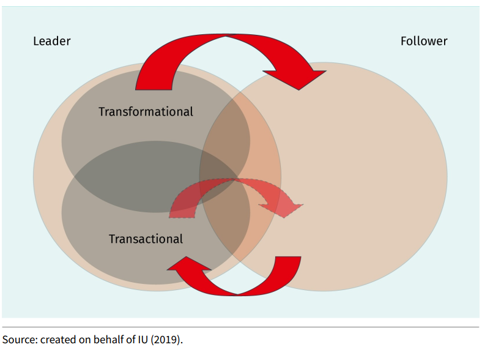

## Stakeholder Management
Consider the following image from a leader's perspective. 
--insert project stakeholders here--
It is segmented into external and internal stakeholders. The stakeholders an organisation deals with in the context of the project could be "an individual, group or organisation that may affect, be affected or perceived itself to be affected by a decision, activity or outcome of a project. The external stakeholders are typically not part of the organisation. This includes clients, suppliers, partners and competitors. Each of the external stakeholders exert a certain level of pressure on the internal layer at a point in time. This affects the leader's actions and goals. The leaders constitute the internal stakeholders, particularly the organisation or project manager. It is the PM's primary responsibility to manage stakeholders i.e identifying the different entities, analyzing their expectations and ability to influence the project, and developing strategies for engaging them in decision-making throughout the project lifecycle.It is worth noting that the project stakeholders can influence the direction of the project, which can be an opportunity or threat to the project. Depending on the level of *interest and power* stakeholders have on a project, they can be segmented into four quadrants as shown in the following image.

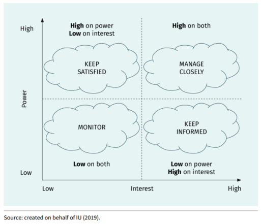

**High Interest - High Power** 
- Must be contineously updated
- Can fail the project anytime
- Must be managed closely
- e.g PMO

**High Interest - Low Power** 
- Very interested in the success of the project
- Can't determine the direction of the project
- Require regular updates but less attention should be given to them
- e.g  suppliers, internal users, developers

**Low Interest - High Power** 
- Must be satisfied 
- Don't need regular update or attention
- If given too much attention, project could be negatively affected.
- e.g customer, regulators, the CEO or CFO of the organization

**Low Interest - Low Power** 
- Least concerned about the project but should be updated
- Have little to no influence on the project
- Cannot be ignored completely but should get lowest attention
- Act like support to the project team
- e.g System admins, technicians, helpdesk etc

Beside the two dimensional *power-interest* model used to classify stakeholders, there is also *the salient model* that combines *power, legitimacy and urgency* in a *Venn* to allow the representation of seven types of stakeholders where some of the stakeholsers might have overlapping needs.

**The Salient Model**
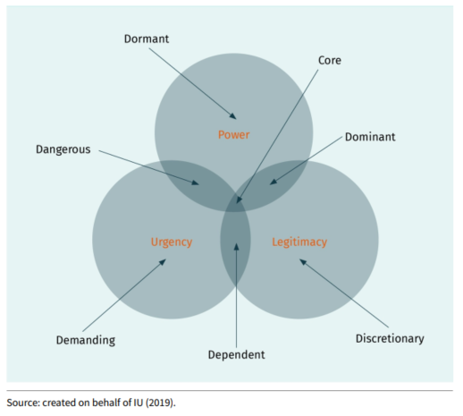

+ The *Power* dimension refers to the level of influence that stakeholders have on the project.
+ The *Legitimacy* dimension refers to the authority and genuineness that stakeholders have on the project
+ The *Urgency* dimension refers to the degree of attention given to stakeholders needs.

The description of overlapping stakeholders is as follows:
- The core or definite stakeholders have high power, legitimacy and urgency require special attention and close management. 
- The *dangerous* stakeholders have the power to interfer without legitimacy. E.g hackers
- The *dependent* can join forces with stakeholders who have power over the project to influence the project. They don't require close management but their presence should not be ignored. E.g communities in the vicinity of the project
- The *dominant* stakeholders require close monitoring but with lesser attention as compared to core stakeholders. E.g compliance bodies who ensure the implementation regulations.
- The *dormant* stakeholders require high level of attention. They might not have direct interest in the project but can stop it abruptly e.g CEO.
- The *discretionary* stakeholders have legitimate interest on the project but no power to affect it. e.g NGOs
- The *demanding* stakeholder are typically affected by the project outcome. They have high urgency but low legitimacy or power on the project.

The salient modell provides better insight into the project stakeholders than other models. As a result the project team can be able to adequately allocate resources, time, and effort to address stakeholders needs. However, this model requires more time and effort to build and maintain and it weights of the stakeholders is subjective.
A role-based approach to stakeholder analysis, to support stakeholder classification, uses the RACI(Responsible, Accountable, Consulted, Informed) model/matrix/chart to clarify responsibilities: *Responsible people do the work e.g developer, Accountable people own the outcome and approve it e.g departmental or team lead, Consulted people provide input e.g BI consultant, and Informed people are kept updated without direct involvement e.g CEO*. This helps assign clear roles, reduce confusion, and improve accountability in project delivery. RACI is often used alongside planning tools such as WBS and Gantt charts to align tasks, responsibilities, and scheduling.

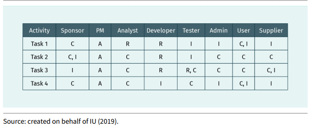

During the implementation of the project, the engagement of stakeholders may vary depending on the level at which the project is. Typically, the level of variation ranges from *Unaware, Resistant, Neutral, Supportive and Leading*. This means that at one stage of the project, a stakeholder may be Resistant i.e knows about the project and its potential impact but resistant to change. At another level, the same stakeholder may have a different role, thus being Neutral i.e aware of the project and its potential impact but is neither supportive nor resistance.

## Conflict Management
Conflict is defined as an intensed disagreement or argument, typically a protracted one. Conflicts in projects can arise from numerous factors including *different working styles, cultural perspectives, accountability, scheduling priorities, checks and balances etc. Though, conflicts like in brainstorming can be productive, in the listed cases it can kill the project depending on the level of motivation that the parties have to resolve it. The following are suggested ways for conflict management:
- Withdraw/avoid: Done
- Force/direct: A win-loose situation between two parties where one has more decision making power than the other. Typically used by leaders for immediate responses.
- Compromise/reconcile: Done
- Collaborate/problem-resolve: Done
- Smooth/accomodate: Done

Conflict management should be treated as a negotiation i.e being ready to give-up something(e.g effort, time, money etc.) to get what you need(e.g money, promotion etc.). During such a negotiation it is important to understand what the other party expects and also be able to clearly communicate your stance. This ensures that the conflict parties can be able to determine their boundaries properly. If required, communication can also be coded. Negotiation occurs in a process with respect to time,typically in the following steps: 
1. *Intelligence* 
Gather information about the issue and parties involved as much as possible.
2. *Perception* 
Make sense out of the information gathered
3. *Strategy* 
Build a strategy to approach the situation
4. *Communication* 
Execute the strategy by communicating your intentions and proporsal coincisely
5. Agreement or Abandonment 
Achieve what we want or loose it.

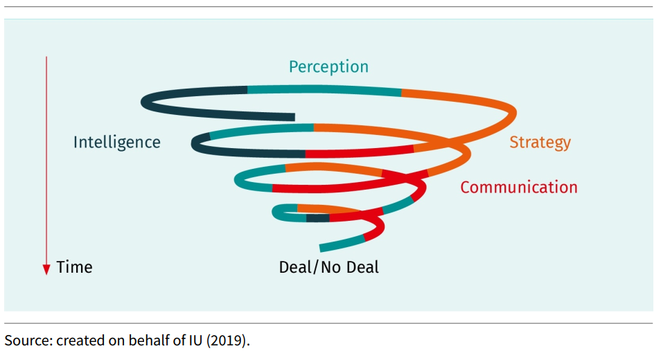

As the negotiation process evolves, based on the situation, the amount of time or effort spent on the individual phases vary. Some phases may require more time than others. The following image shows that the negotiation is dominated by communication.
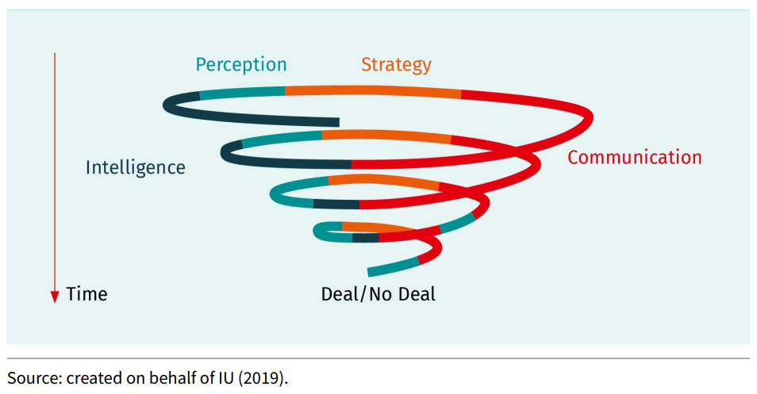

Negotiation can also occur electronically. This is called E-Negotiation i.e negotiation conducted using only electronic means, allowing for more efficiency but can create difficulty when it comes to body language and facial cues.

# UNIT 5: ORGANISING SMALL AND MEDIUM PROJECTS
## INTRODUCTION
IT and software projects vary greatly in size, and small projects often have very small teams where members take on multiple roles. These projects usually rely more on informal communication and less on formal documentation, which can make them flexible and fast. However, they also face risks such as limited resources, weaker quality controls, dependency on individual team members, and gaps in specialized expertise.
## Rational Unified Process (RUP)
Due to the unclear and changing requirements in IT projects, *iterative and incremental* development frameworks have been created and are being adopted by organisations or developers to flexibly handle these changing specifications. In an *iterative* framework, smaller chunks are derived from the whole software development application to facilitate implementation or handling. While in an *incremental* framework, implementation of the large software application starts with the smaller parts and slowly adding the next large parts until the application is fully formed. The *Unified Process(UP)* is one class of these frameworks where the entire project is broken into four core mandatory phases namely, *inception, elaboration, construction and transition* with *production and disposal* being optional. 

**The inception phase**  
This is like a feasibility study where the needs of the business are translated into ideas with a clear scope, initial schedule, cost and identified risks. This also includes requirement engineering, constraints and key features of the project and a prototype where necessary(Gibbs, 2006).
**The Elaboration Phase** 
Based on the requirements, the core elements of the system that will be developed are identified at an abstract level. The structure of the main elements and their relationships can be represented using the Unified Modelling Language (UML) or other tools. The level of risk appetite is equally set at this phase to ensure the future success of the project. This phase is done iteratively.
**The Contruction Phase** 
The application is iteratively developed, tested, and debuged where required. The focus is to deliver a high quality application so quality assurance measures are well tested and documented.
**The Transition Phase** 
The application is shipped to the customer/client. After this, maintenance work like code patching, upgrades, further documentation and optimisation, mostly based on customer request is done. The maintenance work and etc. are done iteratively. So this phase is iterative.
**The Production Phase** 
This optional phase can be added to the project life cycle to enable gather data based on user interaction with the application. This can provide insight necessary for the optimisation of the application.
**The Disposal Phase** 
This phase is equally optional and only required if the customers need to migrate to a replacement system.

The following image shows a *Unified Process* with iterations.
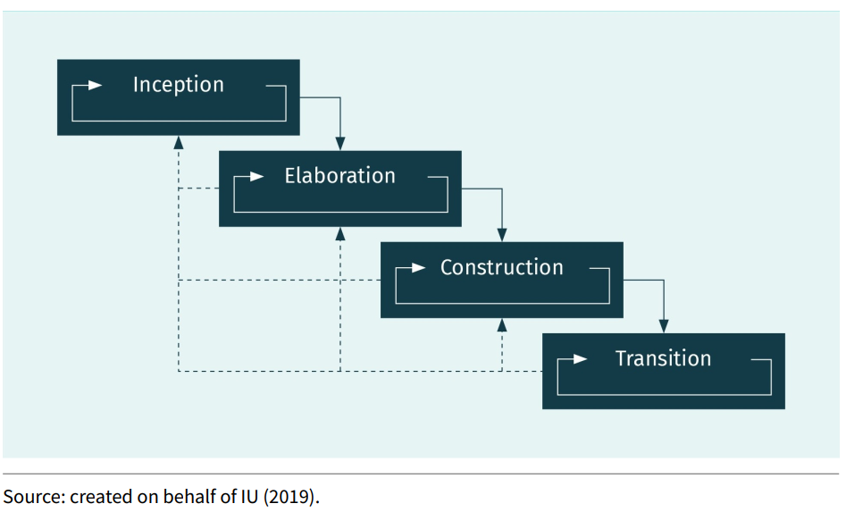

The Rational Unified Process(RUP) builds on the four core phases of the Unified Process, and extends it with the 6 engineering disciplines which include: *business modelling, Requirement gathering, Analysis & Design, Implement, Test, and Deploy*. The workload of the project is distributed accross these disciplines. Each core phase has a given number of iterations defined at the planning phase of the project. The image below illustrates the RUP. The RUP was developed by the Company named Rational but later bought by IBM.

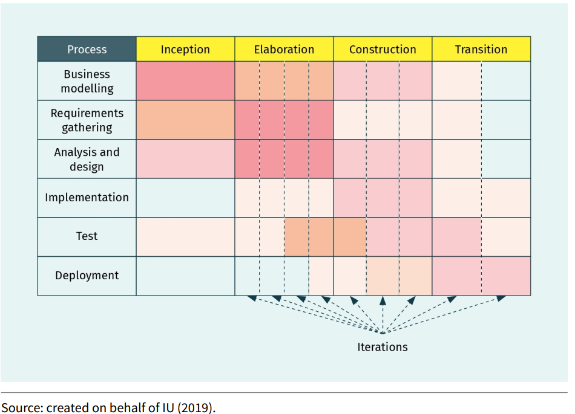

Some best practices that the RUP also incorporates to eliminate errors and increase productivity include:
- Develope iteratively to easily adapt to changes and prioritise quick wins
- Develope reusable components to avoid redundant developments
- Use diagrams like UML to visualise the structure of the system which ensures everyone knows how components are related.
- Perform continuous integration to ensure a seamless process for unifying different components of the system or application.

## Agile Software Processes
The changing specifications of software applications has led to the *development of practices* that produce *prototypes* for testing and experimenting as early as possible. Through this early dectection and resolution of issues, accelerating development and early verification of requirements can be achieved(Gordon & Bieman, 1995). A *prototype*is a learning tool that enable the project team or developers to reduce risks and to learn about the software application to be built. E.g Verifying the user interface or other requirements or checking whether a certain technical concept does indeed work as intended. *Throw-away* prototypes are discarded once the underlying question has been answered while *evolutionary* prototypes are gradually extended and optimised until they mature into the target product. A drawback of prototypes is that it might not contain all the components of the application i.e lack full integration. When accidentally shipped to production, it might not perform as expected. This might cause dissatisfaction from the customers, which can potentially lead to recalls or disputes. To deal with the drawbacks of prototyping, agile approach among others have been developed. *Agile* differs from prototyping in that it leaverages *deliverables* in iterations. Additonally, agile is more of a software engineering "philosophy" or "framework" and a set of guidelines that a simple development practice. It embodies central values and behaviours like *trust, flexibility, empowerment, and collaboration among team members. Its guideliness are subject to the interpretation (Coram & Bohner, 2005). The *agile manifesto* describes the values, behaviours and guideliness for the agile method of working. According to the *Big Design Up Front (BDUF)* which is the traditional life cycle model of pm, the new phase in the project starts after the previous phase is completed. Agile contradicts this phylosophy with reason being that requierements or specifications in software development are often unclear and changing, thus making the BDUF approach counterproductive in software development. The agile software development manifesto describes four agile values as follows:

+ Individuals and interactions over processes and tools
+ Working software over comprehensive documentation
+ Customer collaboration over contract negotiation
+ Responding to change over following a plan

This is followed by the 12 principle which are:
1. "Our highest priority is to satisfy the customer through early and continuous delivery of valuable software.
2. Welcome changing requirements, even late in development. Agile processes harness change for the customer's competitive advantage.
3. Deliver working software frequently, from a couple of weeks to a couple of months, with a preference to the shorter timescale.
4. Businesspeople and developers must work together daily throughout the project.
5. Build projects around motivated indiduals. Give them the environment and support they need, and trust them to get the job done.
6. The most efficient and effective method of conveying information to and within a development team is face-to-face conversation.
7. Working software is the primary measure of progress.
8. Agile processes promote sustainable development. The sponsors, developers, and
users should be able to maintain a constant pace indefinitely.
9. Continuous attention to technical excellence and good design enhances agility.
10. Simplicity—the art of maximizing the amount of work not done—is essential.
11. The best architectures, requirements, and designs emerge from self-organizing teams.
12. At regular intervals, the team reflects on how to become more effective, then tunes
and adjusts its behavior accordingly.”

This approach is essentially a repeated waterfall cycle, where each iteration follows the same project process but includes the customer at every stage. After testing and feedback, the team decides whether to continue the project (“go”) or stop it (“no-go”), allowing problems to be fixed early and avoiding wasted time, effort, or money if the project is no longer viable. An illustration of one iteration of an agile process in form of a waterfall model where the customer appears in every phase is shown below. The aim of each iteration is to deliver a qualitative and functioning deliverable which the customer can validate. At the end of each successfull iteration a working version is released also called a revision. This revision is usually tested and debugged, produce and *build* at the end of the itereation. When significant new features are successfully realeased then it is termed *major release*. Whereas when a function or requirement is completed and released it is termed *minor release*. The versioning scheme followth the formate **major.minor.build.revision**. For instance Verions 4.2.5.9 indicates the fourth major release of the application, the second minor release, the fifth build and the ninth version.

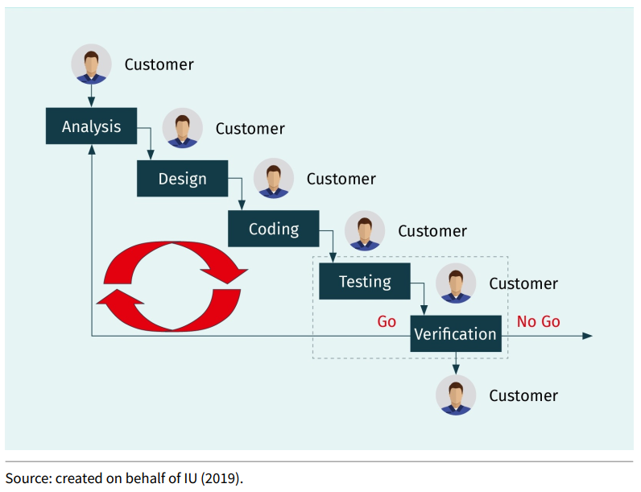

## Scrum
Scrum is a variation of agile where everyone work together to advance development. Scrum was initially used to describe the benefits of self-organising teams in inoovative product development. While traditional PM methods rely on fixed requirments to control cost and schedule, Scrum relies on fixed time and cost to control requirements. This is done by using *time boxes, collaborative ceremonies, a prioritised backlog, and frequent feedback cycles*. Since it encourages self-organised teams, it is more of a framework than a methodology that is prescriped. According to the Scrum Guide, Scrum comprises of Scrum *roles, events, artifacts, and the rules that bind them together*. There are three defined roles in Scrum teams. These are:

+ **Product Owner**
The product owner primarily focuses on maintaining relationships with engineers and stakeholders, as well as the wider business aspects of product development. Other responsibilities include:
    - Make decisions about the solution
    - Prioritise the product backlog. This is the list of features that need to be included in the product or solution.
    - Verify that the product meet expectations(e.g requirements and planning)
    - Demonstrate the product to the stakeholders 
    - Keep the stakeholders upto the date as they are the contact point between developers and business
    - Don't make decisions that affect the iteration i.e suggested changes are moved to the next iteration
+ Scrum master
The Scrum master is responsible for the end product, as well as the monitoring of the production process and conduction of meetings. They are essentially the team leader. Other responsibilities include:
    - similar to the product owner
    - Protect the team from external distractions or pressures
    - Resolve conflicts in the tean
    - Motivate the team and make required resources available to the team
+ Team member
A typical Scrum team consists of five to nine individuals who are jointly responsible for the development of the solution. Their responsibilities include:
    - Decide workload distribution among themselves
    - Determine the length of an iteration
    - Determine what will be worked on during the iteration
    - Report or update each other during their daily scrum(usually 15 minutes) sessions.

The Scrum process starts with product backlog that contains a set of features provided by the customer in order of their importance. The customer also provides a clear vision. The product backlog initiates a series of "time boxed" incremental iterations referred to as **sprints**. Timed boxed because each sprint is time limited i.e all tasks allocated to that sprint is done within that sprint otherwise it is moved to the next sprint. A sprint is not extended for the sake of completing the tasks allocated to it. Typically, a sprint should not exceed a period of one month. The events follow a particular order and include:

- *Sprint planning*: Dev team select a list of items from the product backlog and list them in the sprint backlog. The selected items are implemented in the sprint that is about to start. The items are allocated to the tean members and also discuss how the work will be done 
- *Daily scrum*: Occurs daily and usually last 15 minutes. The dev team members give feedback on the task they are working on, and whether they need assistance or not. 
- *Sprint review*: The team presents the *increment* also called the deliverable from the sprint they just completed. This is presented to the stakeholders. The team gathers feedback for improvement.
- *Sprint retrospective*: This only occurs if the increment from the completed sprint does not meet the specifications of the customer. In this event, the team reflect on the status on the project and think of improvements from feedback for the next sprint.

These iterations or sprints are repeated until the software application is fully implemented and shipped to production.

## Plan-Driven Project Management in small Projects
The development process of small projects is crucial to their success just as the development process of large projects is crucial to their success as well. The effort required to achieve high quality standards in small projects can equate to the same effort required in large projects. This is because small projects might have shortage of resources which leads to individuals taking on multiple roles. Also, team members in small projects face groupthink where the team focuses on the life cycle phases they are familiar with and pay less attention to the other phases. In plan driven projects, an older and most known project managment methodology for the *system development life cycle (SDLC)* is the **waterfall** model. In this model the project is implemented in sequential phases following a downward stream. Each phase is starts and finishes before the next phase starts. This model is classified as a *predictive model*. An illustration of the typical phases of a Waterfall model are illustrated in the following image.

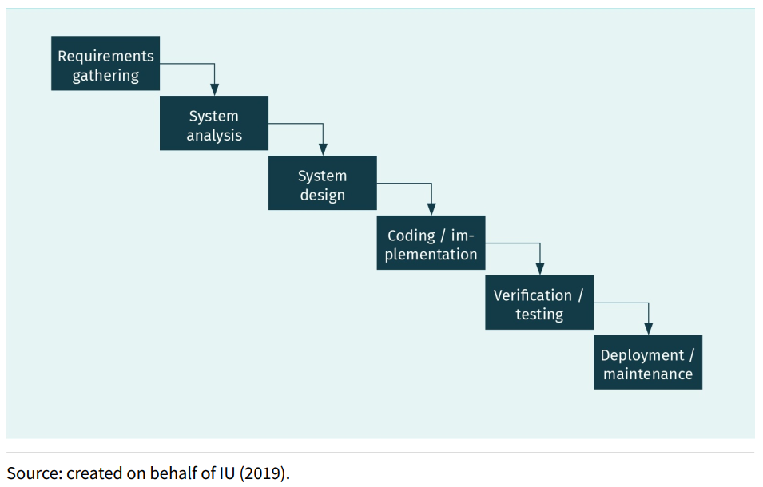

The strict nature of the methodology makes it ideal for small(short-term) projects where the requirements will not change much during the project's lifetime or for projects where quality is of utmost importance. The latter or high quality can only be ensured via proper planning of each phase. This methodology is stable than the agile framework as all requirements have been considered in advanced to ensure that every phase is well planned and structured. Major disadvantage is that, it is very costly if changes must be made at a later phase of the project. To deal with such unexpected changes, variations of the waterfall have been developed. These include:

1. **Waterfall with feedback**
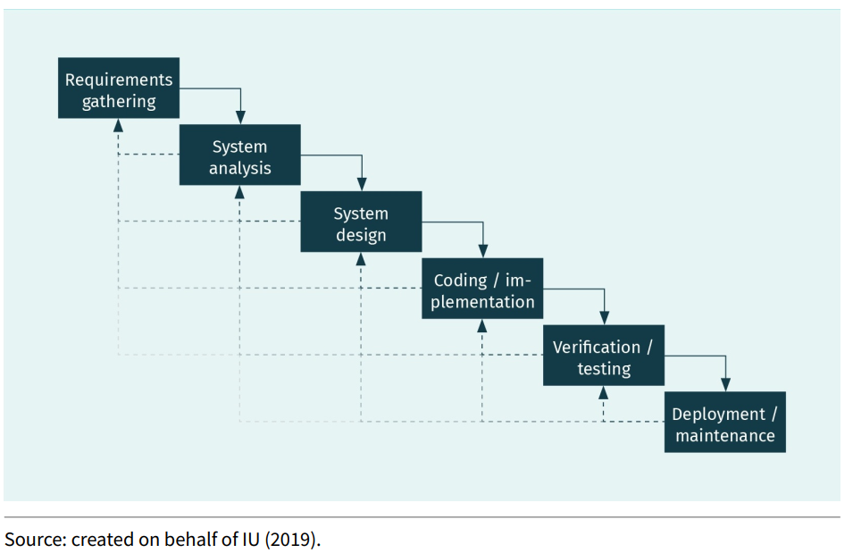

It is possible to iterate between phases to make corrections with the exception that there is no direct return loop between the *requirement gathering phase* and the *Deployment/Maintenance phase*. Iteration can occur between a phase an its subsequent phase but then it is also possible to go back to previous steps.

2. **Waterfall Model with Overlapping Phases (Sashimi)
--insert waterfall with overlapping phases here--
This allows some of the work in one phase to progres to the other phases while the other work is done later. Forinstance, after gathering requirements, some of the these can be moved to the system analysis phase and potentially to the design phase while some requirements are still being discussed with the customer for refinement. This reduces the risk of failure or damage if a specification changes at a later phase.

3. **The V-Model**
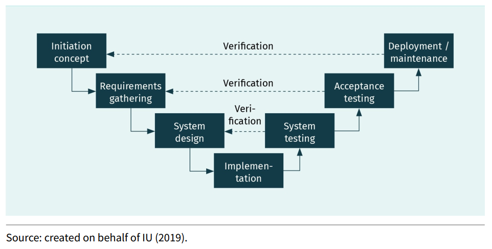
This is waterfall bent into a *V*. and is particulary suitable for small projects when there are high requirements on safety and security i.e there is strong need for reliability and results. Each phase on the left side of the V is mapped to a corresponding phase on the right side of the V. The left side follows a *deductive* approach where tasks is detailly decomposed while the right side follows an *inductive* approach aimed at responding to the corresponding phase on the left side of the V. The core idea is that the product is developed on the left branch while the results are integrated on the right side and verified against the results of the left branch.

# UNIT 6: ORGANISING LARGE PROJECTS

Managing a large project is an endeavour that involves an association of challenging factors like the fast pace technological advances, increased regulation, increased competition from within and across borders etc. Technical advances affect both the management of a project and its products as technology is used both as a tool and a solution. To respond to these challenges, organisations sort their project work into hierarchies with portfolio, program, and project levels, create centralised control structures like dedicated project management offices as well as adopt existing project management methodologies to accommodate their needs. In large IT projects, the system under development is broken down into the smallest units possible that can be implemented. The fluid structure of teams enable developers to move from one team to another when the tasks they were working on is completed. However, this poses a challenge to project managers in terms of cultivating the culture they want.

## PMBOK Guide
As project management was accepted as a profession, the need to formalize it with *principles, knowledge, processes, skills, tools, best practices, techniques, and the organisations of project management professionals inot societies and associations like the *Project Management Institute (PMI) Inc*. became necessary. The purpose of PMI is to develop standards and guideline publications to advise and recommend best practices. Another association is *Project Management Body of Knowledge (PMBOK)* which has become the de facto choice for project managment, especially in large projects, in North America and in some other parts of the world. PMBOK describes the life cycle of a project and its management by considering globally recognised standards and guides that professional project managers have identified as important for the successful execution of projects. ITs guide is divided into two sections, where the first section describes general project management concepts while the remaining section discuss the 47 logically grouped *project management processes*, which are further split into *ten knowledge areas*, that form the guide to the project management body of knowledge. The following images illutrate the 5 project management processes and the ten knowledge areas. 

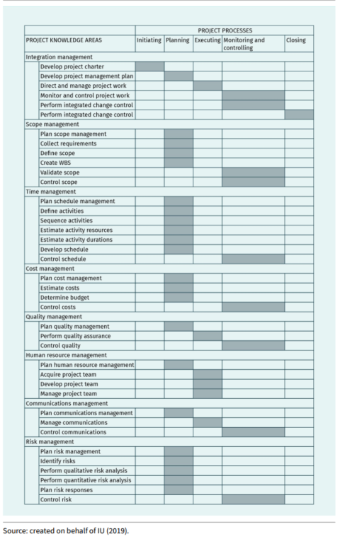
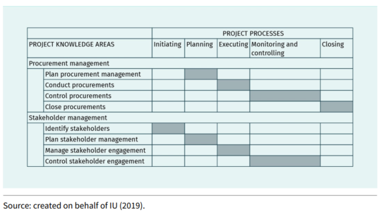

The five project management process groups can be arranged as shown in the following image.

### Description of the PMBOK Process Groups

1. **Initiating** 
The aim of this phase is to ensure that stakeholder participation is assured and that their expectations align with the project's purpose.This is where the vision of the project is formed and made transparent for everyone in this phase.It is made up of two processes to define the project or a phase of a project. Other activities that are covered here include:
- Initial definition of scope and allocation of financial resouces as part of the project charter.
- *Project charter* is a statement of objectives that defines the project goals as well as the roles, and responsibilities of team members.
- Internal and External stakeholders are identified and recorded in the *stakeholder register*. Key stakeholders include sponsors, customers etc.

2. **Planning** 
The planning process group includes 24 processes that are required to:
- Establish the scope of the project
- Refine the objectives
- Define the course of action required to achieve the project's objectives
This phase might be performed repeatedly to refine the plan, handle challenges and provide a clear documentation.

3. **Executing** 
This phase includes eight processes that should be performed to complete the work defined in the project management plan and involves the following activities:
- Coordination people and resources
- Ensures that the project management plan is followed
- Ensure realignment to project objectives and goals if deviations in time, scope or budget occurs.
- Ensure that necessary budget and expertise are available for the implementation of the project.

4. **Monitoring and Controlling** 
This process group includes eleven processes required to track, review and regulate the progress and performance of the project. Other activities include:
- Perform change management
- Measure level of deviation from the plan
- Handle risk related to the project

5. **Close** 
This process group includes two processes performed to finalise all activities across all the process groups to formally close the project, phase or contractual obligations. Other activities include:
- Signal premature closure of the project e.g cancellation, abortion, postponement, handover or transfer to another organisation etc.
- Perform post-mortem review of all project aspects
- Conduct lessons learned
- Update relevant organisational documents
- Disassemble the project team

In the following, the PMBOK projeck knowledge which are grouped into ten areas representing a complete set of *concepts, terms, and activities that make up the professional field of pm will be elaborated.

1. *Project Integration Management Area* 
- Includes six processes
- Ensures the integration i.e unification, consolidation, communication, managing of resources that are crucial to control the execution of the project.
- Manage stakeholder expectations to ensure that their requirement are met
-  Manage interdependencies between the project management knowledge areas

2. *Project Scope Management Area* 
- Includes six processes that are spread between planning and monitoring & controlling.
- Ensures that the team only works on tasks required to successfully complete the project
- Work done is measured based on the project management plan. 
- The development of the features of the software application is measured by the fulfilment of the product requirements

3. *Project Time Management Area* 
- Includes seven processes spread between planning and monitoring & controlling groups
- The processes ensure the completion of the project in time.
- Manage durations on tasks as well as dependencies in the development process
- Ensure that the right tools techniques are used during the implementation tasks

4. *Project Cost Management Area* 
- Includes four processes that are spread between planning and monitoring & controlling groups
- These processes are in charge of handling project cost, planning, resource estimations, budgeting, financing, funding and managing & controlling.
- Also in charge of recuring costs e.g usage, maintenance and support
- Unlike in small projects, managing these cost components is done by different stakeholders as it requires different skillsets, tools and techniques.

5. *Project Quality Management Area* 
- Includes one process for each of the planning and monitoring and controlling.
- This process is in charge of managing quality control policies to ensure the result of the project fulfils quality standards
- Ensuring quality standards is a continuous process. This is recommended to avoid negative consequencies from government or regulatory bodies

6. *Human Resource Management Area* 
- Includes one process in planning and three processes in the executing group.
- These processes is in charge of the organisation and management of the project team
- In charge of hiring or assigning employees with the right skills on the project
- Negotiate salaries and contract type in case of hiring
- Handle conflicts that might occur between members of the project team
- Ensure that project team members are not overwhelmed by the amount of tasks allocated to them

7. *Communications Management Area* 
- Includes one process for each of the planning, executing, and monitoring & controlling groups.
- These processes ensure that activities related to the project like planning, collection, creation, distribution, storage, retrieval, management, controll, monitoring and information sharing are done at the right or expected time.
- Effective communication creates transparancy and ensure that the project team members have the same level of understanding.

8. *Risk Management Knowledge Area* 
- Includes five processes in the planning group and one in the monitoring and controlling group.
- The processes ensure that the team conduct risk management planning, identification, analysis, response planning, and controlling risk.
- Aim at reducing events that can harm the progress of the project while supporting activities that are beneficial to the project. 

9. *Procurement Management Area* 
- Includes one process in every phase except the initiation phase.
- Processes ensure that all procurement decisions are properly documented
- Ensure that all contracts between the organisation and third parties like vendors, solicting offers, monitoring contract performance etc are accurately formulated including the description of the resources being acquired.

10. *Project Stakeholder Management Area* 
- It includes one process in every phase excluding the closing phase.
- Stakeholder management is a project knowledge area used throughout the project lifecycle, except during closing, to identify, manage, engage, and control all people, groups, and organizations affected by or influencing the project.
- Its main focus is to understand stakeholder expectations, maintain continuous communication, and engage stakeholders in decisions and execution.
- It also resolves issues quickly, manages stakeholder conflicts, and keeps stakeholders engaged so project goals are supported and achieved effectively.

## Prince2
This is a process-based project management methodology is a rival to the PMBOK and the acronym stands for *Projects in Controlled Environments*. Its key features include a focus on *business justification, defined organisational structure for the project management team, a product-based approach to planning with flexibility at a level appropriate to the project, and an emphasis on dividing the project into manageable and controllable stages. The varios roles in PRINCE2 are distributed across *four* levels of management which are:
1. Corporate/Program/Management 
This is the top level of management who want to bring the project to life.
2. Directing level 
They are below the corporate level and are the main decisiom-making body of the project
3. Project Manager 
They are below the directing level and are responsible for managing the project on a daily basis
4. Team leaders 
The last level, typically at the operation level, in charge of creating the solution of the project.

This process-based methodology ensures the success of a project via *seven principles, seven themes, and seven processes*.

### The seven principles
These principles are related to the requirement engineering and describe good practices follow during the project life cycle. The processes include:
1. Continued business justification 
The porpose for running and managing the project should be justified and continously documented. This principle ensures that changes occuring in the project life cycle's phase are measured and compared against the project objectives.
2. Focus on products 
The result of obtained at every step needs to be accepted by the stakeholders. The specifications of the products serve as the basis of planning project activities, manage changes, and verifying approval and acceptance of the product.
3. Manage by stages 
The pm team breaks down the project into a number of time periods called *stages*. The duration of each stage is not fixed but the results of each phase must be accepted before the next stage may start.
4. Manage by exception 
Delegation of responsibilites follows a top-down approach i.e higher levels of management can delegate tasks or responsibilities to the level directly beneath them.
5. Define roles and responsibilities 
Every member of the entire project team must fully understand the responsibilities of their role.
6. Tailor to suit the project environment 
Since no project is exactly the same as another, despite similaries they may share, the operational environment of each project must be defined to suit the specifications of the project.
7. Learn from experience 
Mistakes and good practices from past projects can be used in new or future projects to improve its success rate. A *lessons log* is typically used to record previous and current experiences.

### The Seven Themes
These themes provide recommendations for carrying out various aspects of project management. Description of these themes include:
1. Business case 
This theme emphasises on the need for creating a documentation for justifying the purpose of the project, as it helps to keep the project on track.
2. Organisation 
Ensures that the individual roles and responsibilities within the project are defined. This ensures that each project team member understand the role they need to play to ensure the success of the project.
3. Quality 
This theme set the quality requirements and how they are measured. This ensures that the implementation of the project meet given quality standard before the product can be accepted. These criteria can also be part of the definition of done.
4. Plans 
This theme elaborate the steps required to develop a plan. A plan describes the features and functions of the product, the tools and techniques required for development and the skillset required to develop the product as expected. This guides the project team in the selection process of the developers who will implement the solution.
5. Risk 
Taking measures to identify and handle risk. Risk can destroy or benefit the project. Risk that can damage the project should be handle appropriately. The five steps to follow for treating risk include:*identify, assess, plan, implement, and communicate*.
6. Change 
This theme ensures that only authorised people are allowed to approve changes and make configurations that help identify, monitor, and protec the project's product. Sources of change management in this context include *deviations or missing specifications, violations of the project constraints(e.g cost or schedule), and lack of support for the project. All approved changes are documented in the *configuration management strategy document*.
7. Progress 
This theme covers various ways of controlling activities, resources and stakeholders to ensure the project's objectives are achieved. Controlling is done by observing deviations in cost, scheduled and quality from the initial estimates. Each level of management set a level of tolerance above which the next level underneath should not exceed.

Based on the discussed principles and themes, PRINCE2 establishes *seven* processes to showcase the activities required to manage the project. These processes cover the management work from the conceptualisation of the project idea through successfull implementation and acceptance of the sulution from the customer(can either be internal or external). The following image illustrates a *PRINCE2 Model process* indicating and describing the role of each project entity/actor at each process level, including what will be created, reviewed or updated.

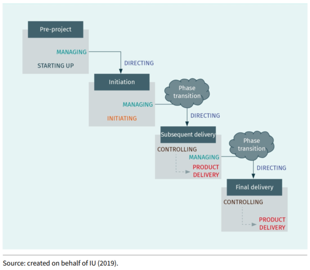

### Description of the seven processes

1. *Starting up a project* 
In this process, the following work is done:
- Feasibility studies on the project
- Establish the project managment team
- Information about the project is made available
- Plan for the next stage is created

2. *Directing a project* 
The following work is done in this process:
- project board plans schedules regarding the start of the project, transition to the next phase and closure of the project
- project board is also in charge of monitoring progress, providing advice and guidance and reacting to exceptions
- project manager covers day-to-day activities of the project

3. *Initiating a project* 
The following work is done in this process.
- The development of the project plan
- The purpose for initiating the project is documented
- Investment of time and effort to fulfil the first stage of the project

4. *Controlling a stage of a project* 
The following activities are done in this process:
- Daily follow-up of the project by the project manager e.g reporting issues, addressing risk and delegating task
- Monitor progress of the project and realigning the project in case of deviations

5. *Managing product delivery* 
The following work is done in this process.
- Implementing all tasks for the development of the end product.
- This include: creating work, accepting it, delivering it and reporting progress

6. *Managing a stage boundary* 
The following work is done in this process:
- Project manager takes measures to ensure every stage of the project is successfully completed
- Activities include: reporting on the status and achievements on the last stage and plan for the next stage
- PM addresses exceptions

7. *Closing the project* 
The following work is done in this process:
- The project manager takes all measures in preparation of closing the project
- This includes activities like: creating a closing report, archiving project documents and handing the product/service to the customer or operational team.

## Multi-Project Management
In modern organisations, multiple projects are executed concurrently/parallely to address the various needs of the organisation, from product and services development upto and including upgrades and maintenance of its infrastructure. Running multiple projects independentl of each other will exhaust resources and limit the company's ability to respond to market needs, and to grow (Miller & Hobbs, 2005). To make multi-project management a success, companies organise projects related activities under a portfolio umbrella in order to manage them in groups. Projects belonging to the same group typically share(interdependency) same program, clients, technologies, staff, expertise and other resources. They can also be part of a general organisational governance structure and strategic initiative, for example, maximising return on investment or sustainable development. A central portfolio ensures alignment with organisational strategies and prioritisation of resource allocation under one command and contrl structure. This allows the company to have an overall view on how the strategic goals are reflected in the portfolio, put in place appropriate governance management, and authorize human, financial or material resources to be allocated based on expected performane and benefits.

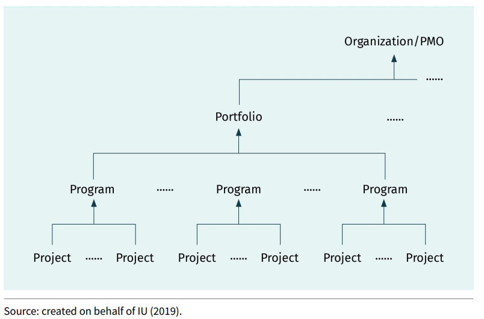

The advantage of this structure is that, each level could be narrowed down to a more specific detail or aggregated to a higher level, to reflect the strategic objectives of an organisation. Planning at the portfolio level require managers to create and maintain necessary proecesses and communications relative to the *aggregate portfolio*, while more specific plans are created at the program level to guide the development of the individual projects. A *aggregate porfolio* is a summary of multiple portfolios and savings plans. Following this structure, project managers are responsible for the day-to-day project activities while the program managers ensure that the overall goals, constraints, and benefits of the program are met. At higher levels, portfolio managers are interested in monitoring strategic changes and allocating resources, estimating the risk of the portfolio and identifying risks as well as developing a risks resolution plans. There are three types of project management office each with its roles and responsibilities. These PMOs are: *Supportive, Controlling or Directive*. The primary function of the PMO is to manage shared resources across all the projects they are in charge of. They identify and develop project management methodologies, best practices, standards, provide coaching, monitoring, training and oversight.

## Agile Software Processes in Large Projects
Agile methodologies were primarilly developed for small teams. However, their popularity and success rates have led larger project teams to adopt tailored versions of them for their needs(Dingsøyr & Moe, 2013). Large projects are related to those that involve more than one independently operating team that could be co-located, distributed across geographical locations, or virtual. The advantage of adopting agile methodologies in large projects is that, it enables large project project management teams to focus on customer which might result in *increased customer satisfaction, rapid delivery, reduced cost and overhead, and the development of products and services that address changing market needs*. The major challenges for scaling agile principles and practices to large projects is related to some characteristics of large project such as *longer planning horizons, levels of authority requiring delegation, synchronisation of deliverables* etc. For instance, in Scrum, the product owner is responsible for the product life cycle including the ROI as well as the market performance. On the other, in large projects, these might be the duties of the program or portfolio managers. Because there is no clear distinction in the levels of authority, this might lead to ambiguity or authorities might get mixed. This can potentially stall the project. To effectivelly manage these challenges, variants of the *agile methodology* like the **Scrum of Scrum(SoS), Scaled Agile Framework(SAFe), and Large-scale Scrum(LeSS)**, among others have been developed. Each of these variants add a layer on top of the individual Scrum teams in order to coordinate their work. These variants are elaborated as follows:

1. **Scrum of Scrum (SoS)** 
It has the following characteristics:
- The project team is divided inot groups of agile teams, typically made up of less than 12 individuals.
- Each team elects a leader named *ambassador*. It could also be the scrum master
- Ambassador participate in a SoS meeting(around 15 minutes) with other ambassadors.
- Ambassadors discuss issues related to development, team boundaries and integration of their solutions
The following illustrates the SoS team structure.

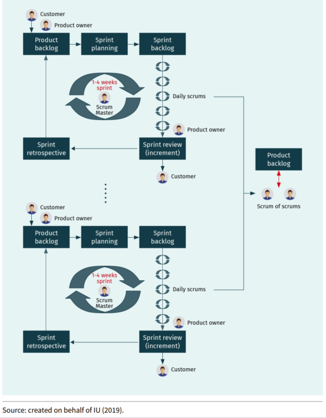

2. **Large-Scale Scrum** 
This variant was developed in an effort to apply Scrum's purpose, elements and elegance to large projects as simple as possible. Because LeSS requires deep organisational changes during scaling, it is perceived an organisational design framework than a project management practice. It exhibits the following characteristics:
- Has a single product backlog
- One definition of done for all teams
- One product owner
- One Sprint
- One increment at the end of each Scrum and cross-functional teams

LeSS differs from SoS in that in inherits Scrum's principles, rules, elements and purpose on a large scale rather than replicating them as an extra Scrum layer. LeSS has the following nine core principles:

+ *Transparency* 
This is evident when the team work together without fear and ship increments at short cycles
+ *More with less* 
More responsibility and accountability with less rules
+ *Whole-product focus* 
This means having one product backlog, one product owner, one shippable product, and one sprint regardless of the number of teams that are allowed.
+ *Customer Centric* 
Focus on customer preferences and interest with the aim of achieving high customer satisfaction
+ *Continuous improvement* 
Taking measures and implementing them to ensure that the product/service/solution gets better from the customer's perspective
+ *Lean thinking* 
Focus on eliminating waste in the work process e.g writing reusable code
+ *System thinking* 
Understanding and optimising the whole system, not just part of it.
+ *Empirical process control* 
Inspecting and adapting the product based on the realities of the market or organisation, rather than blindly following prescribed best practices that ignore context, empede learning and change, and squash people's sense of engagement and ownership
+ *Queuing theory* 
 Queuing theory principles are applied to R&D management to optimize workflow by controlling queue sizes, limiting work-in-progress, reducing multitasking overhead, and managing variability.

3. **SAFe** 
This method exhibits the following characteristics as it scales Scrums's practices in large projects.
- At its core it still considers varying specifications in the development process
- Supports incremental development with integrated learning cycles
- Decentralises decision-making and taking economic view into consideration
- Applies system thinking
- Provides five core compentencies required in lean innovation. These are: (1)lean-agile leadership, (2)team and technical agility, (3)DevOps and release on demand, (4)business solutions and lean systems engineering, and (5)lean portfolio management.

1. *Lean-Agile Leadership*: 
Leaders are the main organisational drivers of change and should thus empower teams to reach their full potentials. Leaders have the authority and the responsibiliy to determine the direction and goals, as well as how work should be done. Leaders also ensure organisational growth, their teams as well as their personal carier growth. Teams build on governance to create values for the organisation.
2. *Team and Technical Agility*:  
Teams members need to adhere to lean-agile principles and poses the technical skills required to develop high-quality solutions that meet customer requirements and future business needs. Accountability and commitments of team members determine their success or failure. Additionally, teams must test their solutions in three steps i.e at code level,story level and finally at the feature level. The solution is only accepted once it passes all these tests.
3. *DevOps and release-on-demand*:  
This competency applies at the program level and describe how development(Dev) and operations(Ops) can enable organisations to quickly address market needs through rapid and frequent delivery. DevOps can be used by team members like product managers, system architecs etc to release value on demand while and continuously work together to optimise the full flow of value through continuos exploration, integration and deployment. These stakeholders have cross-functional responsibilities and are thus part of the *Agile Release Train(ART)*. This is grounded in the five concepts of *Culture, Automation, Lean Flow, Measurement, and Recovery (CALMR)*.

### Description of CALMR components
1. Culture 
Teams should follow the philosophy of shared responsibility for fast value delivery. This includes product management, development, testing, security, compliance and operations.
2. Automation 
Teams should consider eliminating manual work where it is possible and necessary. This reduces performing repeatative tasks, reduces workload and enable the team to focus on developing and leveraging a high-quality solution. Additionally, it reduces the time-to-market span.
3. Lean Flow>br
This enables rapid development and delivery as waste is eliminated on the work flow.
4. Measurement 
This concepts enables the understanding and measurement of the flow of values through the work flow. Through this, teams can learn and conitnously improve their development process.
5. Recovery 
This concept emphasis the need for building systems that allow fast fixes of production issues through automatic rollback and fix-forward capabilities.

4. *Business solutions and Lean systems Engineering* 
SAFe also provide a set of practices for solution builders who require multidisciplinary skills to be able to collaborate and contribute in large projects. These practices include:
+ building solutions components with high-functioning ARTs. 
+ building and integrating with a solution train
+ capturing and refining systems specifications in the solution intent. 
+ applying multiple planning horizons.
+ architecting for scale, modularity, reusability, and serviceability. 
+ managing the supply chain with “systems of systems” thinking. 
+ applying continuous integration. 
+ continually addressing compliance concerns.

5. *Lean Portfolio Management(PLM)
Lean Portfolio Management (LPM) operates at the highest organizational level, implementing lean approaches to strategy, investment funding, portfolio operations, and governance through value streams. It enables organizations to transition from traditional rigid planning and budgeting practices to reliable execution and cross-organizational innovation. SAFe applies LPM through prioritized "epics" (business and enabler types) organized across a hierarchy, with epic owners managing their status and alignment across portfolio, program, and solution levels.

**Advantages of SAFe:**
1. Combines flexibility of a lightweight framework with centralized decision-making at the enterprise level
2. Connects project teams with higher-level organizational strategies and ensures strategic objectives take priority
3. Standardization enables teams to communicate through a common language and coordinate work efficiently

**Disadvantages of SAFe:**
1. Enforces a top-down approach to decision-making and creates overhead through additional layers of oversight, administration, and coordination
2. Emphasis on the big picture can lead to longer planning cycles and more fixed roles within development cycles
3. Excludes front-line actors (developers, testers, product owners) from decision-making at higher levels, preventing valuable feedback from reaching strategic decisions

## Selection of the Appropriate Project Management Method
No single off-the-shelf methodology fits all IT organizations; such approaches are based on faulty assumptions and rarely ensure successful project delivery. Tailor-made methodologies, while requiring significant time and resource investment, provide longer-lasting and customized solutions that better support organizational maturity and growth. Organizational structure emerges through role distribution and hierarchies that enforce how activities are organized. Methodology selection depends on internal and external factors, particularly organizational structure and culture; functional structures offer efficiency but create coordination problems for cross-functional projects, while matrix structures address this through dual reporting relationships.
Matrix organizational structures enable effective cross-functional coordination and resource utilization while requiring careful management to balance competing loyalties and mission alignment. Organizational culture, shaped by structural roles and interpretive design features, is expressed through mission and vision statements and critically influences project organization and performance. Project management methodologies can be classified as predictive (allowing accurate planning for stable, well-structured projects with limited change tolerance) or adaptive (enabling flexible response to changing requirements), with adaptive models further subdivided into iterative approaches (progressively increasing feature completeness), agile approaches (progressively adding features), and incremental approaches (delivering core features at full fidelity first, then expanding). The choice between predictive and adaptive depends on project complexity, resource constraints, requirement clarity, and expected change—with adaptive models preferred when requirements are unclear or expected to evolve.

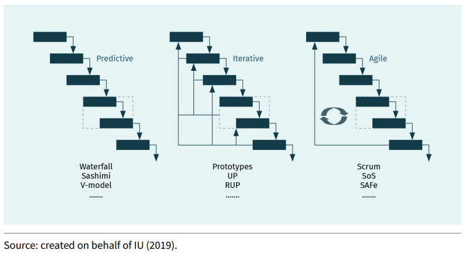

**Predictive Models:**
Comprehensive upfront planning provides clear expectations and early risk management, but inflexible nature prevents beneficial changes.

**Iterative Models:**
Progressively increase feature fidelity from earliest iterations, allowing refinement within a planned framework.

**Agile Models:**
Customization-centered approach with stakeholder participation, progressively adding features with adaptability to project needs.

**Common Requirement:**
Team alignment on model specifics and commitment to delivery within agreed constraints.

